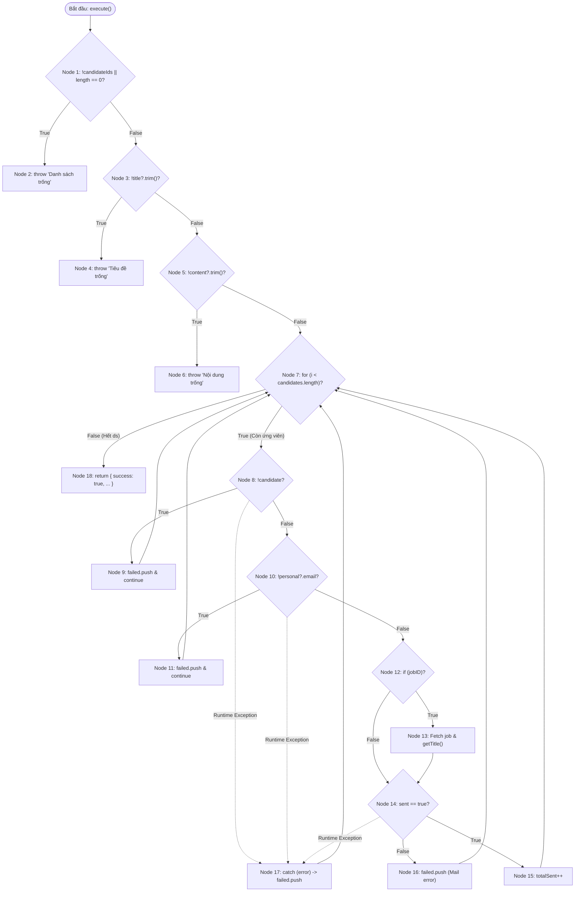

# BÁO CÁO KIỂM THỬ HỘP TRẮNG (WHITE-BOX TESTING)
## USE-CASE 09: TỰ ĐỘNG HÓA GỬI EMAIL TUYỂN DỤNG CHO ỨNG VIÊN (SendBulkEmailUseCase)

---

## THÔNG TIN CHUNG VỀ BÀI TẬP VÀ ĐỐI TƯỢNG KIỂM THỬ

- **Học phần:** Kiểm thử và Đảm bảo chất lượng phần mềm (CSE462)
- **Đề tài:** Hệ thống Quản lý Tuyển dụng – Trợ lý Tuyển dụng & Sàng lọc Hồ sơ Tự động
- **Giảng viên hướng dẫn:** TS. Nguyễn Thị Phương Dung | **Nhóm:** 09
- **Sinh viên thực hiện:** Phạm Văn Hưng (Mã SV: **2351170598**)
- **Mã Use Case:** `UC_09` | **Tên Use Case:** Tự động hóa gửi email tuyển dụng cho ứng viên
- **Đối tượng kiểm thử (Target Under Test):** Lớp `SendBulkEmailUseCase` (Phương thức `execute`)
- **Tệp mã nguồn:** `src/modules/client/application/use-cases/email/send-bulk-email.use-case.ts`
- **Tài liệu lý thuyết tham chiếu:** Giáo trình & Bài giảng *CSE462 - Các kỹ thuật kiểm thử phần mềm*, Trường Đại học Thủy Lợi; Chuẩn quốc tế ISTQB CTFL 2018 v3.1.

---

## 1. MÃ NGUỒN ĐÁNH SỐ DÒNG

Dưới đây là mã nguồn chuẩn hóa của phương thức `execute` thuộc lớp `SendBulkEmailUseCase` được đánh số thứ tự dòng thực thi:

```typescript
1:  async execute(input: SendBulkEmailInput): Promise<SendBulkEmailResult> {
2:    if (!input.candidateIds || input.candidateIds.length === 0) {
3:      throw new Error('Danh sách ứng viên không được để trống.');
4:    }
5:
6:    if (!input.title?.trim()) {
7:      throw new Error('Tiêu đề email không được để trống.');
8:    }
9:
10:   if (!input.content?.trim()) {
11:     throw new Error('Nội dung email không được để trống.');
12:   }
13:
14:   const failed: Array<{
15:     candidateId: string;
16:     candidateName?: string;
17:     error: string;
18:   }> = [];
19:   let totalSent = 0;
20:
21:   const candidatePromises = input.candidateIds.map(id =>
22:     this.candidateRepo.getById(id)
23:   );
24:   const candidates = await Promise.all(candidatePromises);
25:
26:   for (let i = 0; i < candidates.length; i++) {
27:     const candidate = candidates[i];
28:     const candidateId = input.candidateIds[i]!;
29:
30:     try {
31:       if (!candidate) {
32:         failed.push({
33:           candidateId,
34:           error: 'Không tìm thấy ứng viên.',
35:         });
36:         continue;
37:       }
38:
39:       const personal = candidate.getPersonal();
40:       if (!personal?.email) {
41:         failed.push({
42:           candidateId,
43:           candidateName: personal?.fullName,
44:           error: 'Ứng viên không có email.',
45:         });
46:         continue;
47:       }
48:
49:       let jobTitle: string | undefined;
50:       const jobID = candidate.getJobID();
51:       if (jobID) {
52:         try {
53:           const job = await this.jobRepo.getById(jobID.toString());
54:           jobTitle = job?.getTitle();
55:         } catch (e) {
56:           console.warn(`Could not fetch job for candidate ${candidateId}`);
57:         }
58:       }
59:
60:       const personalizedTitle = this.replacePlaceholders(input.title, candidate, jobTitle);
61:       const personalizedContent = this.replacePlaceholders(input.content, candidate, jobTitle);
62:
63:       const htmlContent = `
64:         <html>
65:           <body style="font-family: Arial, sans-serif; line-height: 1.6; color: #333;">
66:             <div style="max-width: 600px; margin: 0 auto; padding: 20px;">
67:               ${personalizedContent.split('\n').map(line => `<p>${line}</p>`).join('')}
68:             </div>
69:           </body>
70:         </html>
71:       `;
72:
73:       const sent = await this.mailSvc.sendEmail(
74:         personal.email,
75:         personalizedTitle,
76:         htmlContent,
77:       );
78:
79:       if (sent) {
80:         totalSent++;
81:       } else {
82:         failed.push({
83:           candidateId,
84:           candidateName: personal?.fullName,
85:           error: 'Lỗi gửi email từ dịch vụ mail.',
86:         });
87:       }
88:     } catch (error: unknown) {
89:       const e = error as { message?: string };
90:       const personal = candidate?.getPersonal();
91:       failed.push({
92:         candidateId,
93:         candidateName: personal?.fullName,
94:         error: e.message ?? 'Lỗi không xác định.',
95:       });
96:     }
97:   }
98:
99:   return {
100:    success: true,
101:    message: `Gửi email thành công tới ${totalSent}/${input.candidateIds.length} ứng viên.`,
102:    totalSent,
103:    failed,
104:  };
105: }
```

---

## 2. BẢNG PHÂN CHIA KHỐI LỆNH CƠ BẢN (BASIC BLOCKS)

Dựa trên nguyên lý khối cơ bản (Basic Block là dãy các câu lệnh thực thi tuần tự, có duy nhất 1 điểm vào và 1 điểm ra), phương thức `execute` được phân tách thành 18 khối lệnh (Nodes):

| Khối (Node) | Dòng mã nguồn | Nội dung thực thi chi tiết | Loại đỉnh (Node Type) |
| :---------: | :------------ | :------------------------- | :-------------------- |
| **Node 1**  | Dòng 1–2      | Tiếp nhận `input`, kiểm tra `if (!input.candidateIds \|\| input.candidateIds.length === 0)` | Decision (Điểm quyết định 1) |
| **Node 2**  | Dòng 3        | `throw new Error('Danh sách ứng viên không được để trống.')` | Exit (Ngoại lệ 1) |
| **Node 3**  | Dòng 6        | Kiểm tra tiêu đề `if (!input.title?.trim())` | Decision (Điểm quyết định 2) |
| **Node 4**  | Dòng 7        | `throw new Error('Tiêu đề email không được để trống.')` | Exit (Ngoại lệ 2) |
| **Node 5**  | Dòng 10       | Kiểm tra nội dung `if (!input.content?.trim())` | Decision (Điểm quyết định 3) |
| **Node 6**  | Dòng 11       | `throw new Error('Nội dung email không được để trống.')` | Exit (Ngoại lệ 3) |
| **Node 7**  | Dòng 14–26    | Khởi tạo `failed = []`, `totalSent = 0`, lấy `candidates`, kiểm tra vòng lặp `for (i < candidates.length)` | Decision / Loop Header (Điểm quyết định 4) |
| **Node 8**  | Dòng 27–31    | Lấy `candidate`, `candidateId`, bắt đầu `try`, kiểm tra `if (!candidate)` | Decision (Điểm quyết định 5) |
| **Node 9**  | Dòng 32–36    | Thêm lỗi `failed.push(...)`, `continue` (quay lại đỉnh vòng lặp Node 7) | Process (Xử lý rẽ nhánh) |
| **Node 10** | Dòng 39–40    | Lấy `personal = candidate.getPersonal()`, kiểm tra `if (!personal?.email)` | Decision (Điểm quyết định 6) |
| **Node 11** | Dòng 41–46    | Thêm lỗi `failed.push(...)`, `continue` (quay lại đỉnh vòng lặp Node 7) | Process (Xử lý rẽ nhánh) |
| **Node 12** | Dòng 49–51    | Khởi tạo `jobTitle`, lấy `jobID`, kiểm tra `if (jobID)` | Decision (Điểm quyết định 7) |
| **Node 13** | Dòng 52–57    | Khối `try-catch` truy vấn công việc `jobRepo.getById(jobID)` lấy `jobTitle` | Process (Xử lý) |
| **Node 14** | Dòng 60–78    | Thay thế `replacePlaceholders`, dựng `htmlContent`, gọi `mailSvc.sendEmail(...)`, kiểm tra `if (sent)` | Decision (Điểm quyết định 8) |
| **Node 15** | Dòng 80       | Tăng biến đếm gửi thành công: `totalSent++` | Process (Xử lý) |
| **Node 16** | Dòng 82–86    | Thêm lỗi gửi mail thất bại: `failed.push(...)` | Process (Xử lý) |
| **Node 17** | Dòng 88–95    | Bắt ngoại lệ khối ngoài: `catch (error) { failed.push(...) }` | Exception Handler (Xử lý ngoại lệ) |
| **Node 18** | Dòng 99–104   | Hết vòng lặp `for`: tạo kết quả và trả về `return { success: true, ... }` | Exit (Thoát bình thường) |

---

## 3. XÂY DỰNG ĐỒ THỊ DÒNG ĐIỀU KHIỂN (CONTROL FLOW GRAPH - CFG)

### 3.1. Đồ thị dòng điều khiển ứng với độ đo C1 và C2 (Statement & Decision Coverage)

Đồ thị dưới đây mô tả dòng điều khiển ở cấp độ khối lệnh cơ bản và phản ánh chính xác các nhánh rẽ nhị phân Đúng (True) / Sai (False):



### 3.2. Đồ thị dòng điều khiển ứng với độ đo C3 (Condition Coverage)

Tại các điểm quyết định có biểu thức điều kiện phức:
- **Node 1:** Biểu thức logic `A || B` trong đó $A$ là `!input.candidateIds` và $B$ là `input.candidateIds.length === 0`.
  - Để đạt độ đo C3, mỗi điều kiện thành phần $A$ và $B$ đều phải nhận độc lập hai giá trị chân lý: **Đúng (True)** và **Sai (False)**.

---

## 4. TÍNH ĐỘ PHỨC TẠP CYCLOMATIC (MCCABE)

Độ phức tạp Cyclomatic $V(G)$ được tính toán độc lập theo 3 phương pháp chuẩn của Thomas McCabe:

### 1. Phương pháp 1: Dựa trên số cung ($E$) và số đỉnh ($N$)
$$V(G) = E - N + 2P$$
Trong đó:
- Số đỉnh (Nodes) $N = 18$.
- Số cung (Edges) $E = 25$ (gồm các nhánh rẽ True/False, cung vòng lặp quay lui và cung chuyển tiếp ngoại lệ).
- Số thành phần liên thông $P = 1$.

$$\Rightarrow V(G) = 25 - 18 + 2(1) = 9$$

### 2. Phương pháp 2: Dựa trên số điểm quyết định vị từ ($P_n$)
$$V(G) = P_n + 1$$
Trong đó $P_n$ là số điểm rẽ nhánh nhị phân (Predicate Nodes) trong đồ thị dòng điều khiển:
1. **Node 1:** `!input.candidateIds || length === 0`
2. **Node 3:** `!input.title?.trim()`
3. **Node 5:** `!input.content?.trim()`
4. **Node 7:** `i < candidates.length`
5. **Node 8:** `!candidate`
6. **Node 10:** `!personal?.email`
7. **Node 12:** `jobID != null`
8. **Node 14:** `sent == true`

$$\Rightarrow P_n = 8 \implies V(G) = 8 + 1 = 9$$

### 3. Phương pháp 3: Dựa trên số miền mặt phẳng khép kín ($R$)
$$V(G) = R$$
Đồ thị phẳng có 8 miền kín bao bọc bởi các chu trình rẽ nhánh và vòng lặp ($R_1 \dots R_8$) cộng thêm 1 miền vô hạn bao quanh bên ngoài ($R_9$):
$$\Rightarrow V(G) = R = 9$$

> **Kết luận:** Độ phức tạp Cyclomatic của phương thức `execute` là **$V(G) = 9$**. Cần tối thiểu **9 đường dẫn cơ sở (Basis Paths)** độc lập tuyến tính để bao phủ toàn bộ đồ thị dòng điều khiển.

---

## 5. THIẾT KẾ CÁC ĐƯỜNG DẪN CƠ SỞ (BASIS PATHS)

| Mã đường dẫn | Chuỗi các khối lệnh (Nodes Sequence) | Mục tiêu bao phủ |
| :---: | :--- | :--- |
| **Path 1** | $1 \rightarrow 2$ | Nhánh lỗi danh sách ứng viên rỗng / undefined |
| **Path 2** | $1 \rightarrow 3 \rightarrow 4$ | Nhánh lỗi tiêu đề email bị để trống |
| **Path 3** | $1 \rightarrow 3 \rightarrow 5 \rightarrow 6$ | Nhánh lỗi nội dung email bị để trống |
| **Path 4** | $1 \rightarrow 3 \rightarrow 5 \rightarrow 7 \rightarrow 18$ | Nhánh danh sách ứng viên hợp lệ nhưng vòng lặp 0 lần (Mảng rỗng sau xử lý) |
| **Path 5** | $1 \rightarrow 3 \rightarrow 5 \rightarrow 7 \rightarrow 8 \rightarrow 9 \rightarrow 7 \rightarrow 18$ | Nhánh không tìm thấy ứng viên trong database (`candidate === null`) |
| **Path 6** | $1 \rightarrow 3 \rightarrow 5 \rightarrow 7 \rightarrow 8 \rightarrow 10 \rightarrow 11 \rightarrow 7 \rightarrow 18$ | Nhánh ứng viên không có địa chỉ email |
| **Path 7** | $1 \rightarrow 3 \rightarrow 5 \rightarrow 7 \rightarrow 8 \rightarrow 10 \rightarrow 12 \rightarrow 14 \rightarrow 16 \rightarrow 7 \rightarrow 18$ | Nhánh không có `jobID`, gửi email qua SMTP thất bại (`sent === false`) |
| **Path 8** | $1 \rightarrow 3 \rightarrow 5 \rightarrow 7 \rightarrow 8 \rightarrow 10 \rightarrow 12 \rightarrow 13 \rightarrow 14 \rightarrow 15 \rightarrow 7 \rightarrow 18$ | Nhánh Happy Path: có `jobID`, truy vấn Job, gửi email thành công |
| **Path 9** | $1 \rightarrow 3 \rightarrow 5 \rightarrow 7 \rightarrow 8 \rightarrow 10 \rightarrow 12 \rightarrow 17 \rightarrow 7 \rightarrow 18$ | Nhánh phát sinh ngoại lệ đột ngột trong khối `try` (Runtime Exception) |

---

## 6. THIẾT KẾ BẢNG CA KIỂM THỬ HỘP TRẮNG (WHITE-BOX TEST CASES)

### 6.1. Bảng ca kiểm thử đáp ứng độ đo C1 (Statement Coverage) & C2 (Branch Coverage)

| Mã Test Case | Đường đi (Basis Path) | Dữ liệu đầu vào (Test Input Data) | Trạng thái Mock / Giả lập hệ thống | Kết quả mong đợi (Expected Output) | Đánh giá |
| :---: | :--- | :--- | :--- | :--- | :---: |
| **TC_WB_01** | Path 1: $1 \rightarrow 2$ | `candidateIds: []`, `title: "Thư mời"`, `content: "Nội dung"` | Không tương tác Repo | Ném ngoại lệ: `'Danh sách ứng viên không được để trống.'` | Đạt |
| **TC_WB_02** | Path 2: $1 \rightarrow 3 \rightarrow 4$ | `candidateIds: ['C01']`, `title: "   "`, `content: "Nội dung"` | Không tương tác Repo | Ném ngoại lệ: `'Tiêu đề email không được để trống.'` | Đạt |
| **TC_WB_03** | Path 3: $1 \rightarrow 3 \rightarrow 5 \rightarrow 6$ | `candidateIds: ['C01']`, `title: "Thư mời"`, `content: ""` | Không tương tác Repo | Ném ngoại lệ: `'Nội dung email không được để trống.'` | Đạt |
| **TC_WB_04** | Path 5: $1 \rightarrow 3 \rightarrow 5 \rightarrow 7 \rightarrow 8 \rightarrow 9 \rightarrow 7 \rightarrow 18$ | `candidateIds: ['CAN_UNKNOWN']`, `title: "Hẹn PV"`, `content: "Chào bạn"` | `candidateRepo.getById('CAN_UNKNOWN')` trả về `null` | Trả về `totalSent: 0`, `failed` chứa `error: 'Không tìm thấy ứng viên.'` | Đạt |
| **TC_WB_05** | Path 6: $1 \rightarrow 3 \rightarrow 5 \rightarrow 7 \rightarrow 8 \rightarrow 10 \rightarrow 11 \rightarrow 7 \rightarrow 18$ | `candidateIds: ['C02']`, `title: "Hẹn PV"`, `content: "Chào bạn"` | Candidate tìm thấy nhưng `personal.email = undefined` | Trả về `totalSent: 0`, `failed` chứa `error: 'Ứng viên không có email.'` | Đạt |
| **TC_WB_06** | Path 7: $1 \rightarrow 3 \rightarrow 5 \rightarrow 7 \rightarrow 8 \rightarrow 10 \rightarrow 12 \rightarrow 14 \rightarrow 16 \rightarrow 7 \rightarrow 18$ | `candidateIds: ['C03']`, `title: "Hẹn PV"`, `content: "Chào [Tên Ứng Viên]"` | Candidate hợp lệ, `jobID = null`, `mailSvc.sendEmail` trả về `false` | Trả về `totalSent: 0`, `failed` chứa `error: 'Lỗi gửi email từ dịch vụ mail.'` | Đạt |
| **TC_WB_07** | Path 8: $1 \rightarrow 3 \rightarrow 5 \rightarrow 7 \rightarrow 8 \rightarrow 10 \rightarrow 12 \rightarrow 13 \rightarrow 14 \rightarrow 15 \rightarrow 7 \rightarrow 18$ | `candidateIds: ['C04']`, `title: "Tuyển dụng [Vị Trí]"`, `content: "Chào [Tên Ứng Viên]"` | Candidate hợp lệ, `jobID = 'JOB_01'`, `jobRepo.getById` trả về Job, `mailSvc.sendEmail` trả về `true` | Trả về `totalSent: 1`, `failed: []`, `message: 'Gửi email thành công tới 1/1 ứng viên.'` (Happy Path) | Đạt |
| **TC_WB_08** | Path 9: $1 \rightarrow 3 \rightarrow 5 \rightarrow 7 \rightarrow 8 \rightarrow 10 \rightarrow 17 \rightarrow 7 \rightarrow 18$ | `candidateIds: ['C05']`, `title: "Hẹn PV"`, `content: "Chào bạn"` | `candidate.getPersonal()` ném ngoại lệ đột ngột: `Error('Crash')` | Khối `catch` bắt lỗi, thêm vào mảng `failed` với thông điệp: `'Crash'` | Đạt |

---

### 6.2. Kiểm tra độ đo bao phủ điều kiện C3 (Condition Coverage cho Node 1)

Biểu thức điều kiện tại Node 1: `!input.candidateIds || input.candidateIds.length === 0`

| Ca kiểm thử C3 | `!input.candidateIds` ($A$) | `input.candidateIds.length === 0` ($B$) | Kết quả biểu thức ($A \lor B$) | Nhánh rẽ | Dữ liệu đầu vào minh họa |
| :---: | :---: | :---: | :---: | :---: | :--- |
| **C3_01** | **True** | Không xét (Short-circuit) | **True** | Node 2 (Ném ngoại lệ) | `input.candidateIds = null` hoặc `undefined` |
| **C3_02** | **False** | **True** | **True** | Node 2 (Ném ngoại lệ) | `input.candidateIds = []` (Mảng rỗng) |
| **C3_03** | **False** | **False** | **False** | Node 3 (Đi tiếp) | `input.candidateIds = ['CAN_01']` |

$\Rightarrow$ **Kết luận C3:** 3 ca kiểm thử trên đảm bảo mỗi điều kiện thành phần $A$ và $B$ đều được đánh giá đầy đủ cả hai giá trị chân lý Đúng (True) và Sai (False), đạt **100% độ bao phủ điều kiện C3**.

---

## 7. ĐÁNH GIÁ ĐỘ ĐO BAO PHỦ VÀ KẾT LUẬN

1. **Độ bao phủ câu lệnh ($C_1$ - Statement Coverage):**
   - Tổng số khối lệnh (Basic Blocks): $18/18$ khối.
   - Số khối được thực thi qua tập Test Cases: $18/18$ khối.
   - **Tỷ lệ bao phủ $C_1$:** $\mathbf{100\%}$.

2. **Độ bao phủ nhánh quyết định ($C_2$ - Branch Coverage):**
   - Tất cả 8 điểm quyết định (Node 1, 3, 5, 7, 8, 10, 12, 14) đều được kích hoạt đầy đủ 2 nhánh **Đúng (True)** và **Sai (False)**.
   - **Tỷ lệ bao phủ $C_2$:** $\mathbf{100\%}$.

3. **Tính độc lập và khả năng bảo trì:**
   - Bộ Test Case bao phủ toàn diện cả các trường hợp biên dữ liệu rỗng (Boundary Values), các nhánh lỗi logic ứng viên không tồn tại, lỗi thiếu email, lỗi dịch vụ gửi thư SMTP bên ngoài và ngoại lệ thời gian chạy (Runtime Exception).
