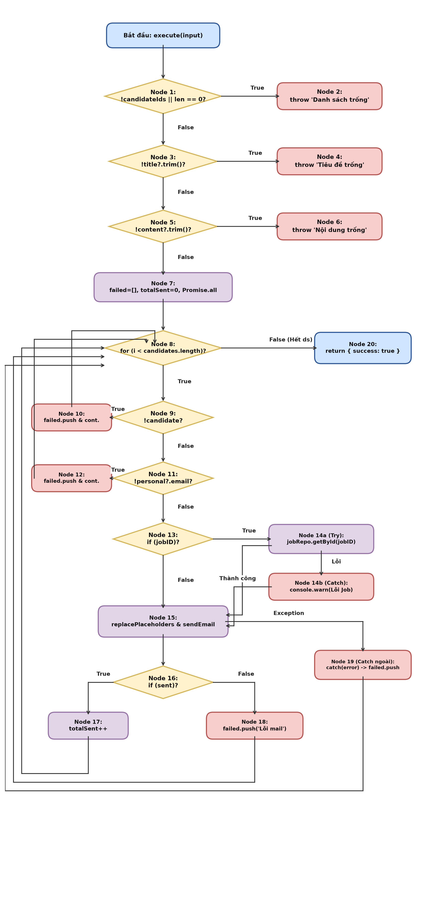
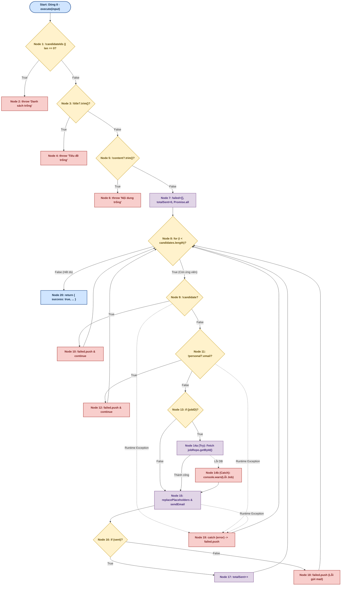
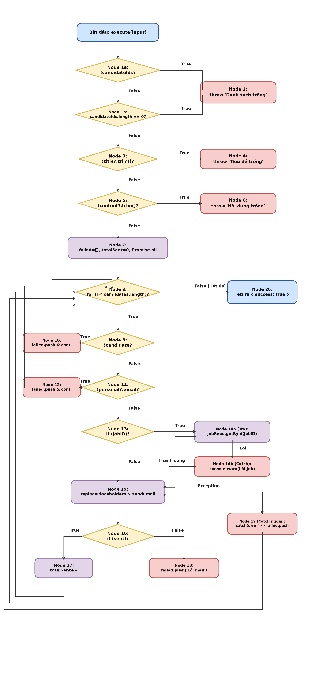
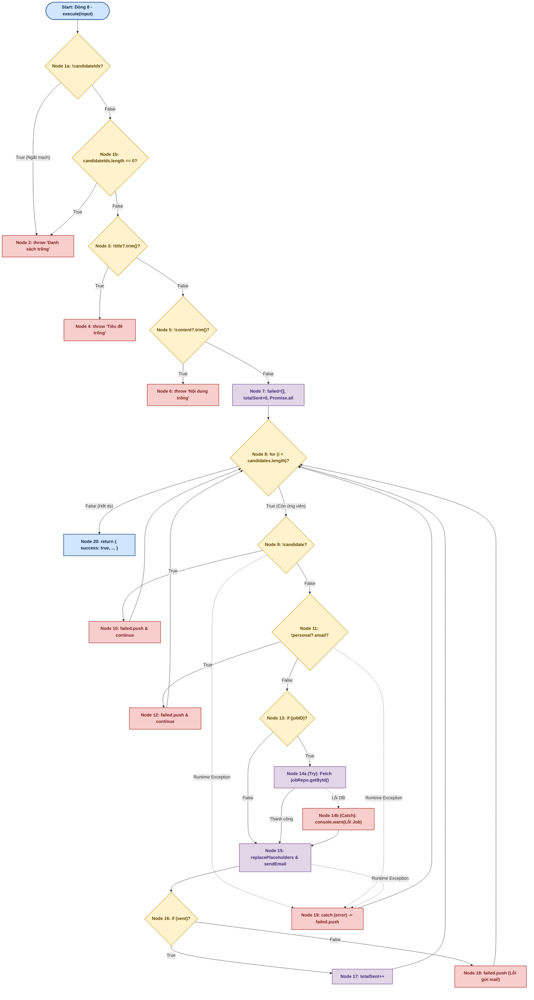

# BÁO CÁO KIỂM THỬ HỘP TRẮNG (WHITE-BOX TESTING)
## USE-CASE 09: TỰ ĐỘNG HÓA GỬI EMAIL TUYỂN DỤNG CHO ỨNG VIÊN (SendBulkEmailUseCase)

---

## THÔNG TIN CHUNG VỀ BÀI TẬP VÀ ĐỐI TƯỢNG KIỂM THỬ

- **Học phần:** Kiểm thử và Đảm bảo chất lượng phần mềm (CSE462)
- **Đề tài:** Hệ thống Quản lý Tuyển dụng – Trợ lý Tuyển dụng & Sàng lọc Hồ sơ Tự động
- **Giảng viên hướng dẫn:** TS. Nguyễn Thị Phương Dung | **Nhóm:** 09
- **Sinh viên thực hiện:** Phạm Văn Hưng (Mã SV: **2351170598**)
- **Mã Use Case:** `UC_09` | **Tên Use Case:** Tự động hóa gửi email tuyển dụng cho ứng viên
- **Đối tượng kiểm thử (Target Under Test):** Lớp `SendBulkEmailUseCase` (Phương thức `execute`)
- **Tệp mã nguồn:** `src/modules/client/application/use-cases/email/send-bulk-email.use-case.ts`
- **Tài liệu lý thuyết tham chiếu:** Giáo trình & Bài giảng *CSE462 - Các kỹ thuật kiểm thử phần mềm*, Trường Đại học Thủy Lợi; Chuẩn quốc tế ISTQB CTFL 2018 v3.1.

---

## 1. MÃ NGUỒN ĐÁNH SỐ DÒNG

Dưới đây là mã nguồn chuẩn hóa của lớp `SendBulkEmailUseCase` được đánh số thứ tự dòng thực thi:

```typescript
1:  class SendBulkEmailUseCase {
2:    constructor(
3:      private readonly candidateRepo: ICandidateReadRepo,
4:      private readonly jobRepo: IJobReadRepo,
5:      private readonly mailSvc: IMailService,
6:    ) { }
7:
8:    async execute(input: SendBulkEmailInput): Promise<SendBulkEmailResult> {
9:      if (!input.candidateIds || input.candidateIds.length === 0) {
10:       throw new Error('Danh sách ứng viên không được để trống.');
11:     }
12:
13:     if (!input.title?.trim()) { 
14:       throw new Error('Tiêu đề email không được để trống.');
15:     }
16:
17:     if (!input.content?.trim()) {
18:       throw new Error('Nội dung email không được để trống.');
19:     }
20:
21:     const failed: Array<{
22:       candidateId: string;
23:       candidateName?: string;
24:       error: string;
25:     }> = [];
26:     let totalSent = 0;
27:
28:     const candidatePromises = input.candidateIds.map(id =>
29:       this.candidateRepo.getById(id)
30:     );
31:     const candidates = await Promise.all(candidatePromises);
32:
33:     for (let i = 0; i < candidates.length; i++) {
34:       const candidate = candidates[i];
35:       const candidateId = input.candidateIds[i]!;
36:
37:       try {
38:         if (!candidate) {
39:           failed.push({
40:             candidateId,
41:             error: 'Không tìm thấy ứng viên.',
42:           });
43:           continue;
44:         }
45:
46:         const personal = candidate.getPersonal();
47:         if (!personal?.email) {
48:           failed.push({
49:             candidateId,
50:             candidateName: personal?.fullName,
51:             error: 'Ứng viên không có email.',
52:           });
53:           continue;
54:         }
55:
56:         let jobTitle: string | undefined;
57:         const jobID = candidate.getJobID();
58:         if (jobID) {
59:           try {
60:             const job = await this.jobRepo.getById(jobID.toString());
61:             jobTitle = job?.getTitle();
62:           } catch (e) {
63:             console.warn(`Could not fetch job for candidate ${candidateId}`);
64:           }
65:         }
66:
67:         const personalizedTitle = this.replacePlaceholders(input.title, candidate, jobTitle);
68:         const personalizedContent = this.replacePlaceholders(input.content, candidate, jobTitle);
69:
70:         const htmlContent = `
71:           <html>
72:             <body style="font-family: Arial, sans-serif; line-height: 1.6; color: #333;">
73:               <div style="max-width: 600px; margin: 0 auto; padding: 20px;">
74:                 ${personalizedContent.split('\n').map(line => `<p>${line}</p>`).join('')}
75:               </div>
76:             </body>
77:           </html>
78:         `;
79:
80:         // Send email
81:         const sent = await this.mailSvc.sendEmail(
82:           personal.email,
83:           personalizedTitle,
84:           htmlContent,
85:         );
86:
87:         if (sent) {
88:           totalSent++;
89:         } else {
90:           failed.push({
91:             candidateId,
92:             candidateName: personal?.fullName,
93:             error: 'Lỗi gửi email từ dịch vụ mail.',
94:           });
95:         }
96:       } catch (error: unknown) {
97:         const e = error as { message?: string };
98:         const personal = candidate?.getPersonal();
99:         failed.push({
100:          candidateId,
101:          candidateName: personal?.fullName,
102:          error: e.message ?? 'Lỗi không xác định.',
103:        });
104:      }
105:    }
106:
107:    return {
108:      success: true,
109:      message: `Gửi email thành công tới ${totalSent}/${input.candidateIds.length} ứng viên.`,
110:      totalSent,
111:      failed,
112:    };
113:  }
114:}
```

*(Ghi chú: Dòng 1–6 là khai báo Class và Constructor Dependency Injection, không chứa luồng điều khiển nghiệp vụ. Đồ thị CFG được xây dựng cho phương thức `execute` từ dòng 8).*

---

## 2. BẢNG PHÂN CHIA KHỐI LỆNH CƠ BẢN (BASIC BLOCKS)

Dựa trên nguyên lý khối cơ bản (Basic Block là dãy các câu lệnh thực thi tuần tự, có duy nhất 1 điểm vào và 1 điểm ra theo chuẩn bài giảng CSE462 - ĐH Thủy Lợi), phương thức `execute` bắt đầu từ dòng 8 và được phân rã thành **22 khối lệnh chi tiết** (gồm đỉnh Start, 20 Node nghiệp vụ, trong đó tách riêng 14a và 14b cho khối try-catch):

| Khối (Node) | Dòng mã nguồn | Nội dung thực thi chi tiết | Loại đỉnh (Node Type) |
| :---------: | :------------ | :------------------------- | :-------------------- |
| **Start**   | Dòng 8        | Bắt đầu hàm `execute(input: SendBulkEmailInput)` | Điểm vào (Entry Point) |
| **Node 1**  | Dòng 9        | Điều kiện `if (!input.candidateIds \|\| input.candidateIds.length === 0)` | Decision (Điểm quyết định 1) |
| **Node 2**  | Dòng 10       | `throw new Error('Danh sách ứng viên không được để trống.')` | Exit (Ngoại lệ 1) |
| **Node 3**  | Dòng 13       | Điều kiện kiểm tra tiêu đề email `if (!input.title?.trim())` | Decision (Điểm quyết định 2) |
| **Node 4**  | Dòng 14       | `throw new Error('Tiêu đề email không được để trống.')` | Exit (Ngoại lệ 2) |
| **Node 5**  | Dòng 17       | Điều kiện kiểm tra nội dung email `if (!input.content?.trim())` | Decision (Điểm quyết định 3) |
| **Node 6**  | Dòng 18       | `throw new Error('Nội dung email không được để trống.')` | Exit (Ngoại lệ 3) |
| **Node 7**  | Dòng 21–31    | Khởi tạo `failed = []`, `totalSent = 0`, lấy `candidates = await Promise.all(...)` | Process (Xử lý chuẩn bị) |
| **Node 8**  | Dòng 33       | Vòng lặp `for (let i = 0; i < candidates.length; i++)` | Decision / Loop Header (Điểm quyết định 4) |
| **Node 9**  | Dòng 34–38    | Lấy `candidate`, `candidateId`, bắt đầu `try`, kiểm tra `if (!candidate)` | Decision (Điểm quyết định 5) |
| **Node 10** | Dòng 39–43    | Thân if: `failed.push(...)`, `continue` (quay lại đỉnh vòng lặp Node 8) | Process (Xử lý rẽ nhánh) |
| **Node 11** | Dòng 46–47    | Lấy `personal = candidate.getPersonal()`, kiểm tra `if (!personal?.email)` | Decision (Điểm quyết định 6) |
| **Node 12** | Dòng 48–53    | Thân if: `failed.push(...)`, `continue` (quay lại đỉnh vòng lặp Node 8) | Process (Xử lý rẽ nhánh) |
| **Node 13** | Dòng 56–58    | Khởi tạo `jobTitle`, lấy `jobID`, kiểm tra `if (jobID)` | Decision (Điểm quyết định 7) |
| **Node 14a**| Dòng 59–61    | Khối `try`: truy vấn công việc `jobRepo.getById(jobID)` và gán `jobTitle` | Process (Xử lý truy vấn thành công) |
| **Node 14b**| Dòng 62–64    | Khối `catch`: bắt lỗi truy vấn Job, ghi log cảnh báo `console.warn(...)` | Exception Handler (Xử lý lỗi truy vấn Job) |
| **Node 15** | Dòng 67–85    | Thay thế placeholder, dựng `htmlContent`, gọi `sent = await mailSvc.sendEmail(...)` | Process (Xử lý gửi mail) |
| **Node 16** | Dòng 87       | Kiểm tra kết quả gửi thư: `if (sent)` | Decision (Điểm quyết định 8) |
| **Node 17** | Dòng 88       | Thân True của if 8: tăng biến đếm `totalSent++` | Process (Xử lý thành công) |
| **Node 18** | Dòng 89–94    | Thân False (else) của if 8: `failed.push('Lỗi gửi email từ dịch vụ mail.')` | Process (Xử lý thất bại) |
| **Node 19** | Dòng 96–103   | Khối bắt ngoại lệ ngoài: `catch (error) { failed.push(...) }` | Exception Handler (Xử lý ngoại lệ runtime) |
| **Node 20** | Dòng 107–112  | Hết vòng lặp `for`: tạo kết quả và trả về `return { success: true, ... }` | Exit (Thoát thành công) |

---

## 3. XÂY DỰNG ĐỒ THỊ DÒNG ĐIỀU KHIỂN (CFG) CHO HÀM THEO C1, C2, C3

### 3.1. Đồ thị dòng điều khiển ứng với độ đo C1 và C2 (Statement & Decision Coverage)

Ở cấp độ độ đo C1 (phủ câu lệnh) và C2 (phủ nhánh quyết định), mỗi khối lệnh điều kiện phức hợp được biểu diễn dưới dạng 1 điểm quyết định đơn vị rẽ 2 nhánh Đúng (True) và Sai (False):





### 3.2. Đồ thị dòng điều khiển ứng với độ đo C3 (Condition / Multiple Condition Coverage)

Theo lý thuyết độ đo C3, các biểu thức điều kiện phức hợp chứa toán tử logic (`||`, `&&`) được phân rã thành các nút quyết định con tương ứng để kiểm tra từng điều kiện thành phần:
- **Tại Node 1 (`!input.candidateIds || input.candidateIds.length === 0`):** Phân rã thành **Node 1a** (`!input.candidateIds`) và **Node 1b** (`input.candidateIds.length === 0`).
- **Cơ chế ngắt mạch (Short-circuit evaluation):**
  - Nếu `Node 1a` nhận giá trị **True** $\rightarrow$ biểu thức lập tức ngắt mạch và nhảy thẳng sang **Node 2** (`throw 'Danh sách ứng viên không được để trống.'`) mà không cần đánh giá `Node 1b`.
  - Nếu `Node 1a` nhận giá trị **False** $\rightarrow$ chuyển sang đánh giá `Node 1b`. Nếu `Node 1b` là **True** $\rightarrow$ nhảy sang **Node 2**. Nếu `Node 1b` là **False** $\rightarrow$ chuyển sang **Node 3**.





---

## 4. TÍNH ĐỘ PHỨC TẠP CYCLOMATIC (MCCABE)

Độ phức tạp Cyclomatic $V(G)$ được tính toán độc lập theo 3 phương pháp chuẩn của Thomas McCabe (chuẩn bài thi môn CSE462):

### 1. Phương pháp 1: Dựa trên số cung ($E$) và số đỉnh ($N$)
$$V(G) = E - N + 2P$$
Trong đó:
- **Số đỉnh (Nodes) $N = 22$**, bao gồm: Đỉnh Start (Dòng 8) + 21 Node (từ Node 1 đến Node 20, trong đó Node 14 gồm Node 14a và Node 14b).
- **Số cung (Edges) $E = 30$**, được liệt kê tường minh gồm:
  1. $(Start \rightarrow 1)$ [Bắt đầu hàm chuyển sang câu lệnh kiểm tra đầu tiên]
  2. $(1 \rightarrow 2)$ [Nhánh True của Node 1: ném lỗi danh sách rỗng]
  3. $(1 \rightarrow 3)$ [Nhánh False của Node 1: kiểm tra tiêu đề]
  4. $(3 \rightarrow 4)$ [Nhánh True của Node 3: ném lỗi tiêu đề rỗng]
  5. $(3 \rightarrow 5)$ [Nhánh False của Node 3: kiểm tra nội dung]
  6. $(5 \rightarrow 6)$ [Nhánh True của Node 5: ném lỗi nội dung rỗng]
  7. $(5 \rightarrow 7)$ [Nhánh False của Node 5: khởi tạo dữ liệu chuẩn bị]
  8. $(7 \rightarrow 8)$ [Chuyển vào vòng lặp for]
  9. $(8 \rightarrow 20)$ [Nhánh False của vòng lặp: hết danh sách ứng viên, thoát vòng lặp]
  10. $(8 \rightarrow 9)$ [Nhánh True của vòng lặp: duyệt ứng viên thứ $i$]
  11. $(9 \rightarrow 10)$ [Nhánh True của Node 9: không tìm thấy ứng viên, ghi lỗi]
  12. $(10 \rightarrow 8)$ [Lệnh continue quay lại đầu vòng lặp Node 8]
  13. $(9 \rightarrow 11)$ [Nhánh False của Node 9: ứng viên tồn tại, kiểm tra email]
  14. $(11 \rightarrow 12)$ [Nhánh True của Node 11: không có email, ghi lỗi]
  15. $(12 \rightarrow 8)$ [Lệnh continue quay lại đầu vòng lặp Node 8]
  16. $(11 \rightarrow 13)$ [Nhánh False của Node 11: có email, kiểm tra jobID]
  17. $(13 \rightarrow 14a)$ [Nhánh True của Node 13: có jobID, vào khối try truy vấn Job]
  18. $(13 \rightarrow 15)$ [Nhánh False của Node 13: không có jobID, bỏ qua bước lấy Job sang tạo thư]
  19. $(14a \rightarrow 15)$ [Truy vấn Job thành công trong khối try, chuyển tiếp sang tạo thư]
  20. $(14a \rightarrow 14b)$ [Truy vấn Job gặp lỗi, rẽ nhánh ném ngoại lệ sang khối catch]
  21. $(14b \rightarrow 15)$ [Xử lý log cảnh báo trong catch xong, tiếp tục luồng tạo thư]
  22. $(15 \rightarrow 16)$ [Thực thi gửi thư xong, chuyển sang kiểm tra kết quả `sent`]
  23. $(16 \rightarrow 17)$ [Nhánh True của Node 16: gửi thành công, tăng biến đếm `totalSent++`]
  24. $(16 \rightarrow 18)$ [Nhánh False của Node 16: gửi thất bại, ghi lỗi vào mảng failed]
  25. $(17 \rightarrow 8)$ [Hoàn thành xử lý ứng viên thành công, quay lại đầu vòng lặp Node 8]
  26. $(18 \rightarrow 8)$ [Hoàn thành xử lý ứng viên thất bại, quay lại đầu vòng lặp Node 8]
  27. $(9 \rightarrow 19)$ [Ngoại lệ bất ngờ tại Node 9 ném ra khối catch ngoài]
  28. $(11 \rightarrow 19)$ [Ngoại lệ bất ngờ tại Node 11 ném ra khối catch ngoài]
  29. $(15 \rightarrow 19)$ [Ngoại lệ bất ngờ tại Node 15 ném ra khối catch ngoài]
  30. $(19 \rightarrow 8)$ [Khối catch ngoài ghi nhận lỗi xong, quay lại đầu vòng lặp Node 8]
- **Số thành phần liên thông $P = 1$** (Chương trình đơn, đồ thị liên thông duy nhất).

$$\Rightarrow V(G) = 30 - 22 + 2(1) = 10$$

### 2. Phương pháp 2: Dựa trên số điểm quyết định vị từ ($P_n$)
$$V(G) = P_n + 1$$
Trong đó $P_n$ là 9 điểm rẽ nhánh nhị phân (gồm 8 câu lệnh điều kiện `if/for` + 1 điểm rẽ ngoại lệ tại khối `try-catch` truy vấn Job):
1. **Node 1:** `!input.candidateIds || length === 0`
2. **Node 3:** `!input.title?.trim()`
3. **Node 5:** `!input.content?.trim()`
4. **Node 8:** `i < candidates.length`
5. **Node 9:** `!candidate`
6. **Node 11:** `!personal?.email`
7. **Node 13:** `jobID != null`
8. **Khối Job Try-Catch (Node 14a/14b):** Rẽ nhánh khi truy vấn Job thành công hoặc ném Exception
9. **Node 16:** `sent == true`

$$\Rightarrow P_n = 9 \implies V(G) = 9 + 1 = 10$$

### 3. Phương pháp 3: Dựa trên số miền mặt phẳng khép kín ($R$)
$$V(G) = R$$
Đồ thị phẳng có 9 miền kín bao bọc bởi các chu trình rẽ nhánh và vòng lặp ($R_1 \dots R_9$) cộng thêm 1 miền vô hạn bao quanh bên ngoài ($R_{10}$):
$$\Rightarrow V(G) = R = 10$$

> **Kết luận:** Cả 3 phương pháp đều tính ra độ phức tạp Cyclomatic của phương thức `execute` là **$V(G) = 10$**. Do đó, cần tối thiểu **10 đường dẫn cơ sở (Basis Paths)** độc lập tuyến tính để bao phủ toàn bộ đồ thị dòng điều khiển.

---

## 5. SINH CÁC ĐƯỜNG ĐI VÀ CA KIỂM THỬ THEO C1, C2, C3

### 5.1. Sinh đường đi và ca kiểm thử ứng với độ đo C1

**Mục tiêu độ đo C1 (Statement Coverage):** Đảm bảo tất cả các khối lệnh (Node) trong đồ thị dòng điều khiển (từ Start, Node 1 đến Node 20, bao gồm cả Node 14a, 14b, 19) đều được thực thi ít nhất một lần qua tập các ca kiểm thử.

| TT | Đường đi theo Node | Dữ liệu đầu vào (Input) | Đầu ra mong đợi | Đầu ra thực tế | Ghi chú |
| :---: | :--- | :--- | :--- | :---: | :--- |
| **C1_01** | $Start \rightarrow 1 \rightarrow 2$ | `candidateIds: []`, `title: "Thư mời phỏng vấn"`, `content: "Nội dung email"` | Ném lỗi: `"Danh sách ứng viên không được để trống."` | Đạt | Phủ Node 1, 2 |
| **C1_02** | $Start \rightarrow 1 \rightarrow 3 \rightarrow 4$ | `candidateIds: ["CAN_01"]`, `title: "   "`, `content: "Nội dung email"` | Ném lỗi: `"Tiêu đề email không được để trống."` | Đạt | Phủ Node 3, 4 |
| **C1_03** | $Start \rightarrow 1 \rightarrow 3 \rightarrow 5 \rightarrow 6$ | `candidateIds: ["CAN_01"]`, `title: "Thư mời phỏng vấn"`, `content: ""` | Ném lỗi: `"Nội dung email không được để trống."` | Đạt | Phủ Node 5, 6 |
| **C1_04** | $Start \rightarrow 1 \rightarrow 3 \rightarrow 5 \rightarrow 7 \rightarrow 8 \rightarrow 9 \rightarrow 10 \rightarrow 8 \rightarrow 20$ | `candidateIds: ["CAN_UNKNOWN"]`, `title: "Thư mời"`, `content: "Chào bạn"`, DB không có ứng viên | Trả về: `totalSent: 0`, `failed` chứa `error: 'Không tìm thấy ứng viên.'` | Đạt | Phủ Node 7, 8, 9, 10, 20 |
| **C1_05** | $Start \rightarrow 1 \rightarrow 3 \rightarrow 5 \rightarrow 7 \rightarrow 8 \rightarrow 9 \rightarrow 11 \rightarrow 12 \rightarrow 8 \rightarrow 20$ | `candidateIds: ["CAN_02"]`, `title: "Thư mời"`, `content: "Chào bạn"`, `personal.email = undefined` | Trả về: `totalSent: 0`, `failed` chứa `error: 'Ứng viên không có email.'` | Đạt | Phủ Node 11, 12 |
| **C1_06** | $Start \rightarrow 1 \rightarrow 3 \rightarrow 5 \rightarrow 7 \rightarrow 8 \rightarrow 9 \rightarrow 11 \rightarrow 13 \rightarrow 15 \rightarrow 16 \rightarrow 18 \rightarrow 8 \rightarrow 20$ | `candidateIds: ["CAN_03"]`, `jobID: null`, `mailSvc.sendEmail` trả về `false` | Trả về: `totalSent: 0`, `failed` chứa `error: 'Lỗi gửi email từ dịch vụ mail.'` | Đạt | Phủ Node 13, 15, 16, 18 |
| **C1_07** | $Start \rightarrow 1 \rightarrow 3 \rightarrow 5 \rightarrow 7 \rightarrow 8 \rightarrow 9 \rightarrow 11 \rightarrow 13 \rightarrow 14a \rightarrow 15 \rightarrow 16 \rightarrow 17 \rightarrow 8 \rightarrow 20$ | `candidateIds: ["CAN_04"]`, `jobID: "JOB_01"`, `jobRepo` tìm thấy Job, `mailSvc.sendEmail` trả về `true` | Trả về: `totalSent: 1`, `failed: []`, `message: "Gửi email thành công tới 1/1 ứng viên."` | Đạt | Phủ Node 14a, 17 (Happy Path) |
| **C1_08** | $Start \rightarrow 1 \rightarrow 3 \rightarrow 5 \rightarrow 7 \rightarrow 8 \rightarrow 9 \rightarrow 11 \rightarrow 13 \rightarrow 14a \rightarrow 14b \rightarrow 15 \rightarrow 16 \rightarrow 17 \rightarrow 8 \rightarrow 20$ | `candidateIds: ["CAN_05"]`, `jobID: "JOB_ERR"`, `jobRepo.getById` ném Exception mạng | Bắt tại Node 14b, ghi log cảnh báo, email vẫn được gửi bình thường, `totalSent: 1` | Đạt | Phủ Node 14b |
| **C1_09** | $Start \rightarrow 1 \rightarrow 3 \rightarrow 5 \rightarrow 7 \rightarrow 8 \rightarrow 9 \rightarrow 11 \rightarrow 19 \rightarrow 8 \rightarrow 20$ | `candidateIds: ["CAN_06"]`, `candidate.getPersonal()` ném ngoại lệ bất ngờ: `Error('DB Crash')` | Bắt tại khối catch ngoài (Node 19), ghi nhận lỗi vào `failed`, `totalSent: 0` | Đạt | Phủ Node 19 |

---

### 5.2. Sinh đường đi và ca kiểm thử ứng với độ đo C2

**Mục tiêu độ đo C2 (Branch / Decision Coverage):** Mỗi điểm quyết định trong đồ thị đều được duyệt qua cả hai nhánh Đúng (True) và Sai (False) ít nhất một lần.

**Bảng ma trận điều kiện rẽ nhánh C2:**

| Điểm quyết định | Biểu thức điều kiện tương ứng | Nhánh Đúng (True) | Nhánh Sai (False) | Ca kiểm thử Đúng | Ca kiểm thử Sai |
| :---: | :--- | :---: | :---: | :---: | :---: |
| **Node 1** | `!input.candidateIds \|\| input.candidateIds.length === 0` | Sang Node 2 | Sang Node 3 | C1_01 | C1_02 |
| **Node 3** | `!input.title \|\| input.title.trim() === ''` | Sang Node 4 | Sang Node 5 | C1_02 | C1_03 |
| **Node 5** | `!input.content \|\| input.content.trim() === ''` | Sang Node 6 | Sang Node 7 | C1_03 | C1_04 |
| **Node 8** | `i < candidates.length` (Vòng lặp `for`) | Sang Node 9 | Sang Node 20 | C1_04 (Lần lặp 1) | C1_04 (Hết mảng) |
| **Node 9** | `!candidate` | Sang Node 10 | Sang Node 11 | C1_04 | C1_05 |
| **Node 11** | `!personal?.email` | Sang Node 12 | Sang Node 13 | C1_05 | C1_06 |
| **Node 13** | `jobID != null` | Sang Node 14a | Sang Node 15 | C1_07 | C1_06 |
| **Node 14a / 14b** | Khối Try/Catch truy vấn `jobRepo.getById(jobID)` | Sang Node 15 (OK) | Sang Node 14b (Lỗi) | C1_07 | C1_08 |
| **Node 16** | `sent == true` (Kết quả gửi email) | Sang Node 17 | Sang Node 18 | C1_07 | C1_06 |

---

### 5.3. Sinh đường đi và ca kiểm thử ứng với độ đo C3 (Phủ điều kiện con)

**Mục tiêu độ đo C3 (Condition / Multiple Condition Coverage):** Các điều kiện con trong biểu thức phức hợp tại **Node 1** (`!input.candidateIds || input.candidateIds.length === 0`) đều nhận cả hai giá trị Chân (True) và Giả (False) ít nhất một lần.

- Ký hiệu:
  - Điều kiện con **$A$**: `!input.candidateIds`
  - Điều kiện con **$B$**: `input.candidateIds.length === 0`
- Cơ chế đánh giá ngắt mạch (**Short-circuit evaluation**) của toán tử logic `||`:
  - Khi $A$ là **True** $\rightarrow$ Biểu thức lập tức nhận giá trị **True**, ngắt mạch và nhảy sang **Node 2** mà không cần đánh giá $B$.
  - Khi $A$ là **False** $\rightarrow$ Hệ thống tiếp tục đánh giá điều kiện con $B$:
    - Nếu $B$ là **True** $\rightarrow$ Biểu thức nhận giá trị **True**, nhảy sang **Node 2**.
    - Nếu $B$ là **False** $\rightarrow$ Biểu thức nhận giá trị **False**, chuyển sang **Node 3**.

**Bảng ma trận điều kiện con C3:**

| Điểm quyết định | Điều kiện con tương ứng | Giá trị kiểm tra | Ca kiểm thử tương ứng | Nhánh thực thi | Kết quả biểu thức |
| :---: | :--- | :---: | :---: | :---: | :---: |
| **Node 1** | $A$: `!input.candidateIds` | True (`candidateIds = null`) | TC_C3_01 | Sang Node 2 | True (Short-circuit ngắt mạch) |
| **Node 1** | $A$: `!input.candidateIds` | False (`candidateIds = []`) | TC_C3_02 | Đánh giá tiếp $B$ | - |
| **Node 1** | $B$: `candidateIds.length === 0` | True (`length = 0`) | TC_C3_02 | Sang Node 2 | True (Lỗi danh sách rỗng) |
| **Node 1** | $B$: `candidateIds.length === 0` | False (`length = 1`) | TC_C3_03 | Sang Node 3 | False (Hợp lệ, đi tiếp) |

**Bảng danh sách ca kiểm thử chi tiết cho độ đo C3:**

| TT | Tên ca kiểm thử | Điều kiện con kích hoạt | Dữ liệu đầu vào (Input) | Đầu ra mong đợi |
| :---: | :--- | :---: | :--- | :--- |
| **TC_C3_01** | Kiểm tra lỗi khi danh sách ứng viên là `null` hoặc `undefined` | $A = \text{True}$ | `candidateIds = null`, `title = "Thư mời"`, `content = "Chào bạn"` | Ném lỗi: `"Danh sách ứng viên không được để trống."` |
| **TC_C3_02** | Kiểm tra lỗi khi danh sách ứng viên là mảng rỗng | $A = \text{False}, B = \text{True}$ | `candidateIds = []`, `title = "Thư mời"`, `content = "Chào bạn"` | Ném lỗi: `"Danh sách ứng viên không được để trống."` |
| **TC_C3_03** | Danh sách ứng viên hợp lệ có phần tử | $A = \text{False}, B = \text{False}$ | `candidateIds = ['CAN_01']`, `title = "Thư mời"`, `content = "Chào bạn"` | Đi tiếp sang Node 3 (Kiểm tra tiêu đề email) |

---

## 6. ĐÁNH GIÁ ĐỘ ĐO BAO PHỦ VÀ KẾT LUẬN

1. **Độ bao phủ câu lệnh ($C_1$ - Statement Coverage):**
   - Đạt **100%** bao phủ tất cả 22/22 khối lệnh (từ Start, Node 1 đến Node 20, bao gồm cả đỉnh ngoại lệ Try 14a, Catch 14b và Catch ngoài Node 19).
2. **Độ bao phủ nhánh quyết định ($C_2$ - Branch Coverage):**
   - Đạt **100%** bao phủ tất cả 9 điểm quyết định rẽ nhánh logic và ngoại lệ đều được duyệt qua cả hai hướng Đúng (True) và Sai (False).
3. **Độ bao phủ điều kiện ($C_3$ - Condition Coverage):**
   - Đạt **100%** cho biểu thức phức hợp tại Node 1 (`!input.candidateIds || input.candidateIds.length === 0`) theo đúng nguyên lý ngắt mạch (Short-circuit).
4. **Tính bền vững và khả năng bảo trì:**
   - Bộ ca kiểm thử hộp trắng bao phủ toàn diện cả các trường hợp biên rỗng, xử lý ngoại lệ mạng cơ sở dữ liệu, kiểm tra tính toàn vẹn dữ liệu ứng viên và bảo đảm tính chịu lỗi (Fault-tolerance) của hệ thống tuyển dụng.
