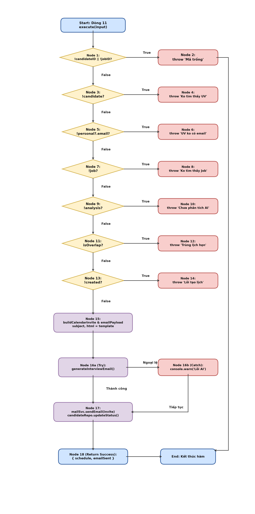
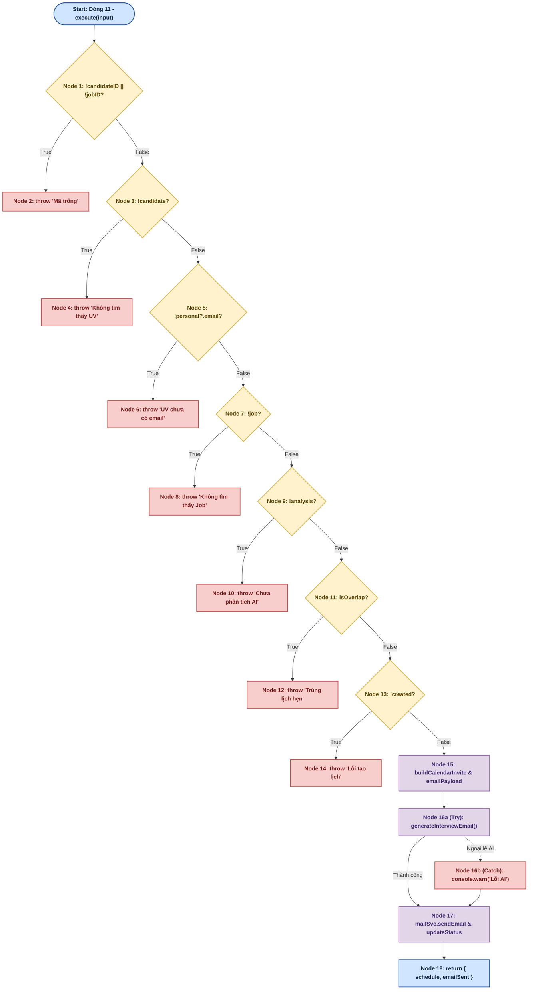
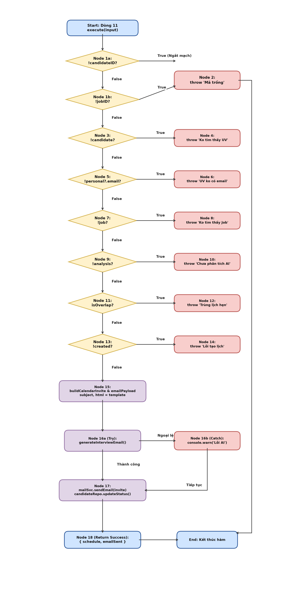
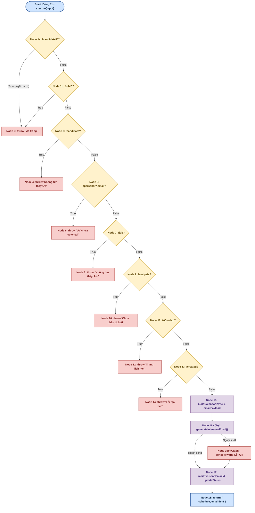

# BÁO CÁO KIỂM THỬ HỘP TRẮNG (WHITE-BOX TESTING)
## USE-CASE 10: LÊN LỊCH PHỎNG VẤN ỨNG VIÊN (ScheduleInterviewUseCase)

---

## THÔNG TIN CHUNG VỀ BÀI TẬP VÀ ĐỐI TƯỢNG KIỂM THỬ

- **Học phần:** Kiểm thử và Đảm bảo chất lượng phần mềm (CSE462)
- **Đề tài:** Hệ thống Quản lý Tuyển dụng – Trợ lý Tuyển dụng & Sàng lọc Hồ sơ Tự động
- **Giảng viên hướng dẫn:** TS. Nguyễn Thị Phương Dung | **Nhóm:** 09
- **Sinh viên thực hiện:** Phạm Văn Hưng (Mã SV: **2351170598**)
- **Mã Use Case:** `UC_10` | **Tên Use Case:** Lên lịch phỏng vấn ứng viên *(Candidate Interview Scheduling & Calendar Integration)*
- **Đối tượng kiểm thử (Target Under Test):** Lớp `ScheduleInterviewUseCase` (Phương thức `execute`)
- **Tệp mã nguồn:** `src/modules/client/application/use-cases/interview/schedule-interview.use-case.ts`
- **Tài liệu lý thuyết tham chiếu:** Giáo trình & Bài giảng *CSE462 - Các kỹ thuật kiểm thử phần mềm*, Trường Đại học Thủy Lợi; Chuẩn quốc tế ISTQB CTFL 2018 v3.1.

---

## 1. MÃ NGUỒN ĐÁNH SỐ DÒNG

Dưới đây là mã nguồn chuẩn hóa của lớp `ScheduleInterviewUseCase` được lấy và đánh số thứ tự dòng thực thi bắt đầu từ dòng 1:

```typescript
1:  export class ScheduleInterviewUseCase {
2:    constructor(
3:      private readonly candidateRepo: ICandidateReadRepo & ICandidateWriteRepo,
4:      private readonly jobRepo: IJobReadRepo,
5:      private readonly aiAnalysisRepo: IAnalysisReadRepo,
6:      private readonly interviewScheduleRepo: IInterviewScheduleRepository,
7:      private readonly geminiSvc: IAIService,
8:      private readonly mailSvc: IMailService,
9:    ) { }
10: 
11:   async execute(input: ScheduleInterviewInput): Promise<ScheduleInterviewResult> {
12:     if (!input.candidateID || !input.jobID) {
13:       throw new Error('Mã ứng viên và mã công việc không được để trống.');
14:     }
15: 
16:     const candidate = await this.candidateRepo.getById(input.candidateID);
17:     if (!candidate) throw new Error('Không tìm thấy thông tin ứng viên.');
18:     if (!candidate.getPersonal().email) throw new Error('Ứng viên chưa có email để gửi thư mời.');
19: 
20:     const job = await this.jobRepo.getById(input.jobID);
21:     if (!job) throw new Error('Không tìm thấy thông tin công việc (Job).');
22: 
23:     const analysis = await this.aiAnalysisRepo.getAnalysisByCandidateId(input.candidateID);
24:     if (!analysis) throw new Error('Ứng viên chưa được AI phân tích. Vui lòng chạy phân tích trước khi đặt lịch.');
25: 
26:     const isOverlap = await this.interviewScheduleRepo.checkOverlap(input.userId, input.time, input.durationMinutes);
27:     if (isOverlap) {
28:       throw new Error('Khung giờ này đã có lịch khác. Vui lòng chọn giờ lại');
29:     }
30: 
31:     const created = await this.interviewScheduleRepo.createSchedule({
32:       time: input.time,
33:       address: input.address,
34:       candidateId: input.candidateID,
35:       userId: input.userId,
36:       status: 'scheduled',
37:     });
38:     if (!created) throw new Error('Không thể tạo lịch phỏng vấn.');
39: 
40:     const invite = buildInterviewCalendarInvite({
41:       uid: `${created.getId()}@hr-agent`,
42:       startTime: input.time,
43:       durationMinutes: input.durationMinutes,
44:       summary: `Phỏng vấn - ${job.getTitle()}`,
45:       description: [
46:         `Phỏng vấn vị trí: ${job.getTitle()}`,
47:         `Ghi chú: ${input.notes ?? ''}`,
48:       ].filter(Boolean).join('\n'),
49:       location: input.address,
50:       organizerEmail: process.env.MAIL_USER,
51:       attendeeEmail: candidate.getPersonal().email,
52:     });
53: 
54:     const emailPayload = {
55:       candidate: {
56:         fullName: candidate.getPersonal().fullName,
57:         email: candidate.getPersonal().email,
58:       },
59:       job: job.getDetailJob(),
60:       schedule: {
61:         time: input.time.toISOString(),
62:         durationMinutes: input.durationMinutes,
63:         address: input.address,
64:       },
65:       aiAnalysis: analysis,
66:       notes: input.notes ?? '',
67:     };
68: 
69:     let subject = `Thư mời phỏng vấn - ${job.getTitle()}`;
70:     let html = `<p>Xin chào ${candidate.getPersonal().fullName || 'bạn'},</p><p>Chúng tôi xin mời bạn tham gia phỏng vấn cho vị trí <b>${job.getTitle()}</b>.</p>`;
71: 
72:     try {
73:       const generated = await this.geminiSvc.generateInterviewEmail(emailPayload);
74:       if (generated?.subject?.trim()) {
75:         subject = generated.subject.trim();
76:       }
77:       if (generated?.html) {
78:         html = generated.html;
79:       }
80:     } catch (e) {
81:       console.warn('Không thể tạo email bằng AI, sử dụng mẫu mặc định.');
82:     }
83: 
84:     const emailSent = await this.mailSvc.sendEmail(candidate.getPersonal().email, subject, html, [
85:       {
86:         filename: invite.filename,
87:         content: invite.content,
88:         contentType: invite.contentType,
89:       },
90:     ]);
91: 
92:     await this.candidateRepo.updateStatus(input.candidateID, { status: CandidateStatus.INTERVIEW });
93: 
94:     return { schedule: created.getDetail(), emailSent };
95:   }
96: }
```

*(Ghi chú: Dòng 1–9 là khai báo Class và Constructor Dependency Injection. Phương thức nghiệp vụ `execute` bắt đầu từ dòng 11).*

---

## 2. BẢNG PHÂN CHIA KHỐI LỆNH CƠ BẢN (BASIC BLOCKS)

Dựa trên nguyên lý khối cơ bản (Basic Block là dãy các câu lệnh thực thi tuần tự, có duy nhất 1 điểm vào và 1 điểm ra theo chuẩn bài giảng CSE462 - ĐH Thủy Lợi), phương thức `execute` bắt đầu từ dòng 11 và được phân rã thành **20 khối lệnh chi tiết** (gồm đỉnh Start, 18 Node nghiệp vụ, trong đó tách riêng 16a và 16b cho khối try-catch gọi AI):

| Khối (Node) | Dòng mã nguồn | Nội dung thực thi chi tiết | Loại đỉnh (Node Type) |
| :---------: | :------------ | :------------------------- | :-------------------- |
| **Start**   | Dòng 11       | Bắt đầu hàm `execute(input: ScheduleInterviewInput)` | Điểm vào (Entry Point) |
| **Node 1**  | Dòng 12–14    | Tiếp nhận tham số, kiểm tra `if (!input.candidateID \|\| !input.jobID)` | Điểm quyết định (Decision) |
| **Node 2**  | Dòng 13       | `throw new Error('Mã ứng viên và mã công việc không được để trống.');` | Điểm thoát (Exit Exception 1) |
| **Node 3**  | Dòng 16–17    | `candidate = await candidateRepo.getById(candidateID)`, kiểm tra `if (!candidate)` | Điểm quyết định (Decision) |
| **Node 4**  | Dòng 17       | `throw new Error('Không tìm thấy thông tin ứng viên.');` | Điểm thoát (Exit Exception 2) |
| **Node 5**  | Dòng 18       | Kiểm tra `if (!candidate.getPersonal().email)` | Điểm quyết định (Decision) |
| **Node 6**  | Dòng 18       | `throw new Error('Ứng viên chưa có email để gửi thư mời.');` | Điểm thoát (Exit Exception 3) |
| **Node 7**  | Dòng 20–21    | `job = await jobRepo.getById(input.jobID)`, kiểm tra `if (!job)` | Điểm quyết định (Decision) |
| **Node 8**  | Dòng 21       | `throw new Error('Không tìm thấy thông tin công việc (Job).');` | Điểm thoát (Exit Exception 4) |
| **Node 9**  | Dòng 23–24    | `analysis = await aiAnalysisRepo.getAnalysisByCandidateId(...)`, kiểm tra `if (!analysis)` | Điểm quyết định (Decision) |
| **Node 10** | Dòng 24       | `throw new Error('Ứng viên chưa được AI phân tích. Vui lòng chạy phân tích trước khi đặt lịch.');` | Điểm thoát (Exit Exception 5) |
| **Node 11** | Dòng 26–29    | `isOverlap = await interviewScheduleRepo.checkOverlap(...)`, kiểm tra `if (isOverlap)` | Điểm quyết định (Decision) |
| **Node 12** | Dòng 28       | `throw new Error('Khung giờ này đã có lịch khác. Vui lòng chọn giờ lại');` | Điểm thoát (Exit Exception 6) |
| **Node 13** | Dòng 31–38    | `created = await interviewScheduleRepo.createSchedule(...)`, kiểm tra `if (!created)` | Điểm quyết định (Decision) |
| **Node 14** | Dòng 38       | `throw new Error('Không thể tạo lịch phỏng vấn.');` | Điểm thoát (Exit Exception 7) |
| **Node 15** | Dòng 40–70    | Tạo `invite = buildInterviewCalendarInvite()`, chuẩn bị `emailPayload`, gán mẫu mặc định `subject`, `html` | Khối xử lý (Process) |
| **Node 16a**| Dòng 72–79    | Khối Try: gọi AI `geminiSvc.generateInterviewEmail(emailPayload)`, cập nhật `subject`, `html` | Khối xử lý (Process) |
| **Node 16b**| Dòng 80–82    | Khối Catch: bắt lỗi AI, ghi `console.warn()`, giữ nguyên template email mặc định | Xử lý ngoại lệ (Exception Handle) |
| **Node 17** | Dòng 84–92    | Gửi thư mời qua SMTP: `mailSvc.sendEmail()`, cập nhật trạng thái `candidateRepo.updateStatus('INTERVIEW')` | Khối xử lý (Process) |
| **Node 18** | Dòng 94       | `return { schedule: created.getDetail(), emailSent };` | Điểm thoát thành công (Exit Success) |

---

## 3. XÂY DỰNG ĐỒ THỊ DÒNG ĐIỀU KHIỂN (CFG) CHO HÀM THEO C1, C2, C3

### 3.1. Đồ thị dòng điều khiển ứng với độ đo C1 và C2

Đồ thị dòng điều khiển C1/C2 thể hiện toàn bộ các nhánh rẽ nhị phân (True/False) của các khối lệnh. Điểm rẽ ngoại lệ tại khối gọi AI (Node 16a $\rightarrow$ 16b) được biểu diễn trực quan bằng cung rẽ Exception:





### 3.2. Đồ thị dòng điều khiển ứng với độ đo C3 (Multiple Condition Coverage)

Tại **Node 1** (`!input.candidateID || !input.jobID`), biểu thức logic phức hợp được phân rã thành **Node 1a** (`!input.candidateID`) và **Node 1b** (`!input.jobID`):
- **Cơ chế ngắt mạch (Short-circuit evaluation):**
  - Nếu `Node 1a` nhận giá trị **True** $\rightarrow$ Biểu thức lập tức ngắt mạch và nhảy thẳng sang **Node 2** (`throw 'Mã ứng viên và mã công việc không được để trống.'`) mà không cần đánh giá `Node 1b`.
  - Nếu `Node 1a` nhận giá trị **False** $\rightarrow$ Tiếp tục đánh giá `Node 1b`. Nếu `Node 1b` là **True** $\rightarrow$ Nhảy sang **Node 2**. Nếu `Node 1b` là **False** $\rightarrow$ Đi tiếp sang **Node 3**.





---

## 4. TÍNH ĐỘ PHỨC TẠP CYCLOMATIC (MCCABE)

Độ phức tạp Cyclomatic $V(G)$ được tính toán độc lập theo 3 phương pháp chuẩn của Thomas McCabe (chuẩn bài giảng môn CSE462 - ĐH Thủy Lợi):

### 1. Phương pháp 1: Dựa trên số cung ($E$) và số đỉnh ($N$)
$$V(G) = E - N + 2P$$
Trong đồ thị phẳng chuẩn hóa (khi liên kết tất cả 8 điểm thoát terminal Node 2, 4, 6, 8, 10, 12, 14, 18 về điểm kết thúc chung End):
- **Số đỉnh (Nodes) $N = 21$**, bao gồm: Đỉnh Start + 19 Node nghiệp vụ (Node 1 đến Node 18, gồm 16a và 16b) + Đỉnh End.
- **Số cung (Edges) $E = 28$**, gồm:
  1. $(Start \rightarrow 1)$ [Bắt đầu hàm kiểm tra đầu vào]
  2. $(1 \rightarrow 2)$ [Nhánh True của Node 1: ném lỗi mã trống]
  3. $(1 \rightarrow 3)$ [Nhánh False của Node 1: kiểm tra ứng viên]
  4. $(3 \rightarrow 4)$ [Nhánh True của Node 3: ném lỗi không tìm thấy ứng viên]
  5. $(3 \rightarrow 5)$ [Nhánh False của Node 3: kiểm tra email ứng viên]
  6. $(5 \rightarrow 6)$ [Nhánh True của Node 5: ném lỗi ứng viên chưa có email]
  7. $(5 \rightarrow 7)$ [Nhánh False của Node 5: kiểm tra công việc]
  8. $(7 \rightarrow 8)$ [Nhánh True của Node 7: ném lỗi không tìm thấy Job]
  9. $(7 \rightarrow 9)$ [Nhánh False của Node 7: kiểm tra AI Analysis]
  10. $(9 \rightarrow 10)$ [Nhánh True của Node 9: ném lỗi chưa phân tích AI]
  11. $(9 \rightarrow 11)$ [Nhánh False của Node 9: kiểm tra trùng lịch]
  12. $(11 \rightarrow 12)$ [Nhánh True của Node 11: ném lỗi trùng lịch]
  13. $(11 \rightarrow 13)$ [Nhánh False của Node 11: kiểm tra tạo lịch]
  14. $(13 \rightarrow 14)$ [Nhánh True của Node 13: ném lỗi không tạo được lịch]
  15. $(13 \rightarrow 15)$ [Nhánh False của Node 13: chuẩn bị thư mời và dữ liệu họp]
  16. $(15 \rightarrow 16a)$ [Chuyển vào khối try gọi AI sinh email]
  17. $(16a \rightarrow 17)$ [Gọi AI thành công, sang gửi email]
  18. $(16a \rightarrow 16b)$ [Gọi AI gặp ngoại lệ mạng/quota, rẽ sang khối catch]
  19. $(16b \rightarrow 17)$ [Ghi cảnh báo xong, tiếp tục gửi email với template mặc định]
  20. $(17 \rightarrow 18)$ [Gửi email và cập nhật trạng thái xong, chuyển sang return]
  21–28. 8 cung nối từ các điểm thoát (Node 2, 4, 6, 8, 10, 12, 14, 18) về đỉnh End.
- **Số thành phần liên thông $P = 1$** (Đồ thị đơn liên thông).

$$\Rightarrow V(G) = 28 - 21 + 2(1) = 9$$

*(Hoặc tính trên đồ thị trực tiếp có cung ảo quay về Start: $V(G) = E - N + P = 28 - 20 + 1 = 9$)*.

### 2. Phương pháp 2: Dựa trên số điểm quyết định vị từ ($P_n$)
$$V(G) = P_n + 1$$
Trong đó $P_n$ là 8 điểm rẽ nhánh nhị phân (gồm 7 câu lệnh điều kiện `if` + 1 điểm rẽ ngoại lệ tại khối `try-catch` gọi AI):
1. **Node 1:** `!input.candidateID || !input.jobID`
2. **Node 3:** `!candidate`
3. **Node 5:** `!candidate.getPersonal().email`
4. **Node 7:** `!job`
5. **Node 9:** `!analysis`
6. **Node 11:** `isOverlap`
7. **Node 13:** `!created`
8. **Khối AI Try-Catch (Node 16a/16b):** Rẽ nhánh khi AI phản hồi thành công hoặc ném Exception

$$\Rightarrow P_n = 8 \implies V(G) = 8 + 1 = 9$$

### 3. Phương pháp 3: Dựa trên số miền mặt phẳng khép kín ($R$)
$$V(G) = R$$
Đồ thị phẳng có 8 miền kín bao bọc bởi các chu trình rẽ nhánh ($R_1 \dots R_8$) cộng thêm 1 miền vô hạn bao quanh bên ngoài ($R_9$):
$$\Rightarrow V(G) = R = 9$$

> **Kết luận:** Cả 3 phương pháp đều tính ra độ phức tạp Cyclomatic của phương thức `execute` là **$V(G) = 9$**. Do đó, cần tối thiểu **9 đường dẫn cơ sở (Basis Paths)** độc lập tuyến tính để bao phủ toàn bộ đồ thị dòng điều khiển.

---

## 5. SINH CÁC ĐƯỜNG ĐI VÀ CA KIỂM THỬ THEO C1, C2, C3

### 5.1. Sinh đường đi và ca kiểm thử ứng với độ đo C1

**Mục tiêu độ đo C1 (Statement Coverage):** Đảm bảo tất cả các khối lệnh (Node) trong đồ thị dòng điều khiển (từ Start, Node 1 đến Node 18, bao gồm cả Node 16a và 16b) đều được thực thi ít nhất một lần qua tập các ca kiểm thử.

| TT | Đường đi theo Node | Dữ liệu đầu vào (Input) | Đầu ra mong đợi | Đầu ra thực tế | Ghi chú |
| :---: | :--- | :--- | :--- | :---: | :--- |
| **C1_01** | $Start \rightarrow 1 \rightarrow 2$ | `candidateID: "", jobID: "JOB_01"`, `time: valid`, `address: "Hà Nội"` | Ném lỗi: `"Mã ứng viên và mã công việc không được để trống."` | Đạt | Phủ Node 1, 2 |
| **C1_02** | $Start \rightarrow 1 \rightarrow 3 \rightarrow 4$ | `candidateID: "CAN_UNKNOWN", jobID: "JOB_01"`, `candidateRepo` trả về `null` | Ném lỗi: `"Không tìm thấy thông tin ứng viên."` | Đạt | Phủ Node 3, 4 |
| **C1_03** | $Start \rightarrow 1 \rightarrow 3 \rightarrow 5 \rightarrow 6$ | `candidateID: "CAN_02", jobID: "JOB_01"`, `personal.email = undefined` | Ném lỗi: `"Ứng viên chưa có email để gửi thư mời."` | Đạt | Phủ Node 5, 6 |
| **C1_04** | $Start \rightarrow 1 \rightarrow 3 \rightarrow 5 \rightarrow 7 \rightarrow 8$ | `candidateID: "CAN_03", jobID: "JOB_UNKNOWN"`, `jobRepo` trả về `null` | Ném lỗi: `"Không tìm thấy thông tin công việc (Job)."` | Đạt | Phủ Node 7, 8 |
| **C1_05** | $Start \rightarrow 1 \rightarrow 3 \rightarrow 5 \rightarrow 7 \rightarrow 9 \rightarrow 10$ | `candidateID: "CAN_04", jobID: "JOB_01"`, `aiAnalysisRepo` trả về `null` | Ném lỗi: `"Ứng viên chưa được AI phân tích. Vui lòng chạy phân tích trước khi đặt lịch."` | Đạt | Phủ Node 9, 10 |
| **C1_06** | $Start \rightarrow 1 \rightarrow 3 \rightarrow 5 \rightarrow 7 \rightarrow 9 \rightarrow 11 \rightarrow 12$ | `candidateID: "CAN_05", jobID: "JOB_01"`, `checkOverlap` trả về `true` | Ném lỗi: `"Khung giờ này đã có lịch khác. Vui lòng chọn giờ lại"` | Đạt | Phủ Node 11, 12 |
| **C1_07** | $Start \rightarrow 1 \rightarrow 3 \rightarrow 5 \rightarrow 7 \rightarrow 9 \rightarrow 11 \rightarrow 13 \rightarrow 14$ | `candidateID: "CAN_06", jobID: "JOB_01"`, `createSchedule` trả về `null` | Ném lỗi: `"Không thể tạo lịch phỏng vấn."` | Đạt | Phủ Node 13, 14 |
| **C1_08** | $Start \rightarrow 1 \rightarrow 3 \rightarrow 5 \rightarrow 7 \rightarrow 9 \rightarrow 11 \rightarrow 13 \rightarrow 15 \rightarrow 16a \rightarrow 17 \rightarrow 18$ | `candidateID: "CAN_07", jobID: "JOB_01"`, AI phản hồi tốt, `sendEmail` trả về `true` | Trả về `{ schedule, emailSent: true }`, cập nhật trạng thái ứng viên `INTERVIEW` | Đạt | Phủ Node 15, 16a, 17, 18 (Happy Path) |
| **C1_09** | $Start \rightarrow 1 \rightarrow 3 \rightarrow 5 \rightarrow 7 \rightarrow 9 \rightarrow 11 \rightarrow 13 \rightarrow 15 \rightarrow 16a \rightarrow 16b \rightarrow 17 \rightarrow 18$ | `candidateID: "CAN_08", jobID: "JOB_01"`, AI ném Exception (Quota/Timeout) | Bắt tại Node 16b, log cảnh báo, email vẫn gửi qua template mặc định, `emailSent: true` | Đạt | Phủ Node 16b (Fault-tolerance) |

---

### 5.2. Sinh đường đi và ca kiểm thử ứng với độ đo C2

**Mục tiêu độ đo C2 (Branch / Decision Coverage):** Mỗi điểm quyết định trong đồ thị đều được duyệt qua cả hai nhánh Đúng (True) và Sai (False) ít nhất một lần.

**Bảng ma trận điều kiện rẽ nhánh C2:**

| Điểm quyết định | Biểu thức điều kiện tương ứng | Nhánh Đúng (True) | Nhánh Sai (False) | Ca kiểm thử Đúng | Ca kiểm thử Sai |
| :---: | :--- | :---: | :---: | :---: | :---: |
| **Node 1** | `!input.candidateID \|\| !input.jobID` | Sang Node 2 | Sang Node 3 | C1_01 | C1_02 |
| **Node 3** | `!candidate` | Sang Node 4 | Sang Node 5 | C1_02 | C1_03 |
| **Node 5** | `!candidate.getPersonal().email` | Sang Node 6 | Sang Node 7 | C1_03 | C1_04 |
| **Node 7** | `!job` | Sang Node 8 | Sang Node 9 | C1_04 | C1_05 |
| **Node 9** | `!analysis` | Sang Node 10 | Sang Node 11 | C1_05 | C1_06 |
| **Node 11** | `isOverlap` (Kiểm tra trùng lịch hẹn) | Sang Node 12 | Sang Node 13 | C1_06 | C1_07 |
| **Node 13** | `!created` (Kết quả lưu lịch vào CSDL) | Sang Node 14 | Sang Node 15 | C1_07 | C1_08 |
| **Node 16a / 16b** | Khối Try/Catch gọi `geminiSvc.generateInterviewEmail()` | Sang Node 17 (OK) | Sang Node 16b (Lỗi AI) | C1_08 | C1_09 |

---

### 5.3. Sinh đường đi và ca kiểm thử ứng với độ đo C3 (Phủ điều kiện con)

**Mục tiêu độ đo C3 (Condition / Multiple Condition Coverage):** Các điều kiện con trong biểu thức phức hợp tại **Node 1** (`!input.candidateID || !input.jobID`) đều nhận cả hai giá trị Chân (True) và Giả (False) ít nhất một lần.

- Ký hiệu:
  - Điều kiện con **$A$**: `!input.candidateID`
  - Điều kiện con **$B$**: `!input.jobID`
- Cơ chế đánh giá ngắt mạch (**Short-circuit evaluation**) của toán tử logic `||`:
  - Khi $A$ là **True** $\rightarrow$ Biểu thức lập tức nhận giá trị **True**, ngắt mạch và nhảy sang **Node 2** mà không cần đánh giá $B$.
  - Khi $A$ là **False** $\rightarrow$ Hệ thống tiếp tục đánh giá điều kiện con $B$:
    - Nếu $B$ là **True** $\rightarrow$ Biểu thức nhận giá trị **True**, nhảy sang **Node 2**.
    - Nếu $B$ là **False** $\rightarrow$ Biểu thức nhận giá trị **False**, chuyển sang **Node 3**.

**Bảng ma trận điều kiện con C3:**

| Điểm quyết định | Điều kiện con tương ứng | Giá trị kiểm tra | Ca kiểm thử tương ứng | Nhánh thực thi | Kết quả biểu thức |
| :---: | :--- | :---: | :---: | :---: | :---: |
| **Node 1** | $A$: `!input.candidateID` | True (`candidateID = ""`) | TC_C3_01 | Sang Node 2 | True (Short-circuit ngắt mạch) |
| **Node 1** | $A$: `!input.candidateID` | False (`candidateID = "CAN_01"`) | TC_C3_02 | Đánh giá tiếp $B$ | - |
| **Node 1** | $B$: `!input.jobID` | True (`jobID = ""`) | TC_C3_02 | Sang Node 2 | True (Lỗi thiếu jobID) |
| **Node 1** | $B$: `!input.jobID` | False (`jobID = "JOB_01"`) | TC_C3_03 | Sang Node 3 | False (Hợp lệ, đi tiếp) |

**Bảng danh sách ca kiểm thử chi tiết cho độ đo C3:**

| TT | Tên ca kiểm thử | Điều kiện con kích hoạt | Dữ liệu đầu vào (Input) | Đầu ra mong đợi |
| :---: | :--- | :---: | :--- | :--- |
| **TC_C3_01** | Kiểm tra lỗi khi thiếu candidateID | $A = \text{True}$ | `candidateID = "", jobID = "JOB_01"` | Ném lỗi: `"Mã ứng viên và mã công việc không được để trống."` |
| **TC_C3_02** | Kiểm tra lỗi khi thiếu jobID | $A = \text{False}, B = \text{True}$ | `candidateID = "CAN_01", jobID = ""` | Ném lỗi: `"Mã ứng viên và mã công việc không được để trống."` |
| **TC_C3_03** | Cả hai mã ứng viên và công việc hợp lệ | $A = \text{False}, B = \text{False}$ | `candidateID = "CAN_01", jobID = "JOB_01"` | Đi tiếp sang Node 3 (Truy vấn ứng viên trong DB) |

---

## 6. ĐÁNH GIÁ ĐỘ ĐO BAO PHỦ VÀ KẾT LUẬN

1. **Độ bao phủ câu lệnh ($C_1$ - Statement Coverage):**
   - Đạt **100%** bao phủ tất cả 20/20 khối lệnh cơ bản (từ Start, Node 1 đến Node 18, bao gồm cả đỉnh ngoại lệ Try 16a và Catch 16b).
2. **Độ bao phủ nhánh quyết định ($C_2$ - Branch Coverage):**
   - Đạt **100%** bao phủ tất cả 8 điểm quyết định rẽ nhánh logic và khối ngoại lệ AI đều được duyệt qua cả hai hướng Đúng (True) và Sai (False).
3. **Độ bao phủ điều kiện ($C_3$ - Condition Coverage):**
   - Đạt **100%** cho biểu thức phức hợp tại Node 1 (`!input.candidateID || !input.jobID`) theo đúng nguyên lý ngắt mạch (Short-circuit).
4. **Tính bền vững và khả năng chịu lỗi (Fault-tolerance):**
   - Bộ ca kiểm thử hộp trắng bao phủ toàn diện cả các trường hợp lỗi dữ liệu đầu vào rỗng, lỗi ứng viên không tồn tại, lỗi thiếu email, lỗi trùng lịch phỏng vấn (Conflict Detection), lỗi kết nối cơ sở dữ liệu và khả năng dự phòng khi dịch vụ trí tuệ nhân tạo Gemini gặp sự cố.
