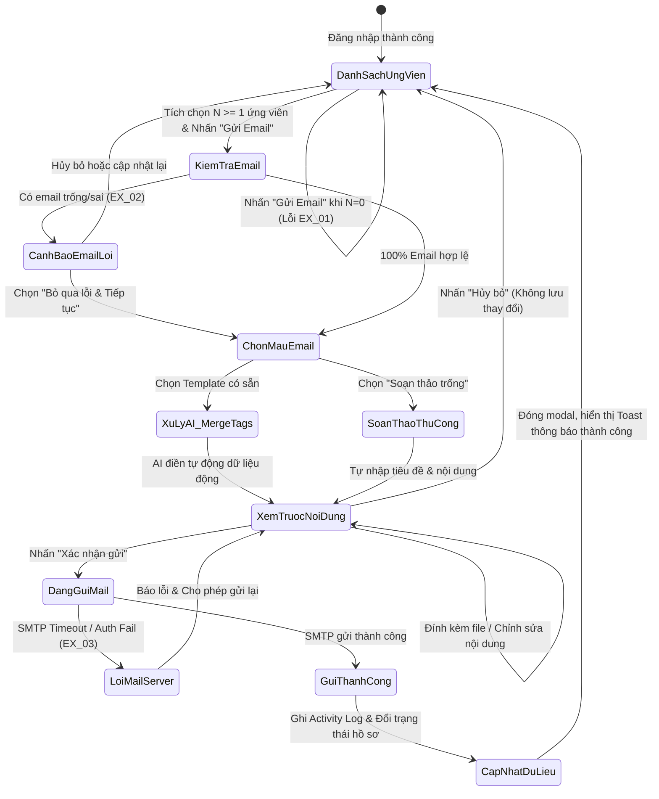

# TÀI LIỆU ĐẶC TẢ CA KIỂM THỬ
## HỌC PHẦN: KIỂM THỬ VÀ ĐẢM BẢO CHẤT LƯỢNG PHẦN MỀM (CSE462)
### BÀI TẬP LỚN / USE CASE: UC_09 - TỰ ĐỘNG HÓA GỬI EMAIL TUYỂN DỤNG CHO ỨNG VIÊN

---

## 📌 PHẦN 1: THÔNG TIN CHUNG

- **Mã Use Case:** `UC_09`
- **Tên Use Case:** Tự động hóa gửi email tuyển dụng cho ứng viên *(Automated Candidate Recruitment Email)*
- **Người đảm nhận / Tạo:** Phạm Văn Hưng
- **Ngày tạo:** 30/01/2026
- **Tác nhân chính (Actor):** Chuyên viên tuyển dụng (HR / Recruiter)
- **Tác nhân phụ (Secondary Actor):** Hệ thống máy chủ thư điện tử (Mail Server / SMTP Service)
- **Mục tiêu Use Case:** 
  1. Cho phép Chuyên viên tuyển dụng nhanh chóng liên hệ với một hoặc nhiều ứng viên thông qua email tuyển dụng chuyên nghiệp.
  2. Ứng dụng trợ lý AI tự động cá nhân hóa nội dung thư (điền họ tên, chức danh ứng tuyển, lịch phỏng vấn, mức lương...) dựa trên các mẫu email tuyển dụng chuẩn hóa (*Smart Email Templates*).
  3. Cung cấp cơ chế soạn thảo thủ công linh hoạt và hỗ trợ đính kèm tài liệu tuyển dụng (JD, bài test kỹ năng, thư mời nhận việc Offer Letter).
  4. Tự động đồng bộ và cập nhật trạng thái vòng tuyển dụng của ứng viên (ví dụ: chuyển sang *"Đã liên hệ"*, *"Mời phỏng vấn"*), đồng thời lưu vết đầy đủ vào nhật ký lịch sử hoạt động (*Activity Log / Audit Trail*).
- **Tiêu chuẩn học thuật và kỹ thuật áp dụng:**
  - Giáo trình Kiểm thử và Đảm bảo chất lượng phần mềm (**CSE462**) – Trường Đại học Thủy Lợi.
  - Chuẩn kiểm thử quốc tế **ISTQB CTFL 2018 v3.1** (Black-box Test Techniques).
  - Tiêu chuẩn quy trình kiểm thử phần mềm **ISO/IEC/IEEE 29119-4**.
  - Tiêu chuẩn mô hình chất lượng phần mềm **ISO/IEC 25010** (Functionality, Reliability, Usability, Security).

---

## 🎯 PHẦN 2: PHÂN TÍCH CƠ SỞ KIỂM THỬ

Dựa trên bản mô tả nghiệp vụ của tác giả Phạm Văn Hưng và kiến trúc hệ thống Quản lý tuyển dụng thông minh, nhóm kiểm thử chuẩn hóa các điều kiện và phân rã luồng sự kiện chi tiết như sau:

### 1. Điều kiện tiên quyết (Pre-conditions)
1. Chuyên viên tuyển dụng đã đăng nhập thành công vào hệ thống quản trị tuyển dụng (Token JWT còn hiệu lực).
2. Tài khoản chuyên viên có phân quyền gửi email liên hệ ứng viên.
3. Hồ sơ ứng viên đã tồn tại trong CSDL và có địa chỉ Email được xác thực.
4. Cấu hình Mail Server (SMTP / SendGrid / AWS SES) đang hoạt động bình thường.
5. Danh mục mẫu email (*Email Templates*) đã được thiết lập sẵn trong hệ thống (Mời phỏng vấn, Thư cảm ơn/Từ chối, Gửi Offer, Yêu cầu làm bài test...).

### 2. Hậu điều kiện (Post-conditions)
1. Email tuyển dụng được chuyển phát thành công đến máy chủ nhận thư của ứng viên.
2. Nội dung thư, người gửi, thời gian gửi và danh sách người nhận được lưu trữ vĩnh viễn trong mục "Lịch sử hoạt động" (*Activity Log*) của từng hồ sơ ứng viên.
3. Trạng thái vòng tuyển dụng của ứng viên tự động được cập nhật tương ứng (ví dụ: từ *"Mới"* $\rightarrow$ *"Đã liên hệ"*, hoặc sang *"Chờ phỏng vấn"*).
4. Số lượng email gửi trong ngày được cập nhật vào bảng đo lường KPI / Quota tuyển dụng.

### 3. Phân rã luồng sự kiện (Flow of Events)

#### A. Luồng chính (Main Flow) - Gửi email đơn lẻ / hàng loạt bằng Mẫu AI:
1. **Bước 1:** Chuyên viên tuyển dụng truy cập vào màn hình "Danh sách ứng viên" trên Dashboard.
2. **Bước 2:** Chuyên viên tích chọn một (hoặc nhiều) ứng viên cần liên hệ từ danh sách, sau đó nhấn nút chức năng **"Gửi Email"**.
3. **Bước 3:** Hệ thống kiểm tra hợp lệ dữ liệu đầu vào:
   - Kiểm tra có ít nhất một ứng viên được chọn.
   - Kiểm tra định dạng địa chỉ Email của tất cả các ứng viên đã chọn.
4. **Bước 4:** Hệ thống hiển thị Modal hộp thoại **"Soạn & Gửi Email Tuyển Dụng"** kèm danh mục các mẫu thư khả dụng (*Templates*).
5. **Bước 5:** Chuyên viên tuyển dụng chọn một mẫu email phù hợp với mục đích (Ví dụ: *"Mời phỏng vấn Vòng 1"*).
6. **Bước 6:** Trợ lý AI tự động trích xuất thông tin ứng viên (Họ tên, Vị trí ứng tuyển, Ngày nộp đơn...) để cá nhân hóa và điền tự động vào các thẻ dữ liệu động (*Merge Tags / Dynamic Placeholders*) của mẫu thư.
7. **Bước 7:** Hệ thống hiển thị bản xem trước (*Preview*) nội dung email hoàn chỉnh. Chuyên viên rà soát, chỉnh sửa bổ sung thông tin (thời gian, địa điểm, link họp online) nếu cần.
8. **Bước 8:** Chuyên viên nhấn nút **"Xác nhận gửi"**.
9. **Bước 9:** Hệ thống kết nối Mail Server, thực hiện gửi email bất đồng bộ qua hàng đợi (*Queue*).
10. **Bước 10:** Hệ thống thông báo thành công: *"Đã gửi email thành công đến [N] ứng viên"*, tự động đóng Modal, cập nhật trạng thái hồ sơ ứng viên và ghi nhận vào lịch sử hoạt động (*Activity Log*).

#### B. Các luồng thay thế (Alternative Flows):
- **Luồng 5a (Soạn thảo thủ công từ mẫu trống):**
  - *5a.1:* Tại bước 5, chuyên viên không chọn mẫu có sẵn mà nhấn chọn tùy chọn **"Soạn thảo trống"** (*Blank Template*).
  - *5a.2:* Chuyên viên tự nhập tiêu đề (*Subject*) và nội dung email bằng trình soạn thảo Rich-Text Editor (hoặc Markdown).
  - *5a.3:* Chuyển tiếp sang Bước 8 để gửi thư.
- **Luồng 7a (Đính kèm tệp tin bổ sung):**
  - *7a.1:* Tại bước 7, chuyên viên bấm nút "Đính kèm tệp" (*Attach File*) để đính kèm JD chi tiết, bài kiểm tra kỹ năng hoặc Thư mời nhận việc dạng PDF.
  - *7a.2:* Hệ thống kiểm tra dung lượng và định dạng tệp đính kèm ($\le 10\text{MB}$, không chứa virus/mã độc).
  - *7a.3:* Tiếp tục Bước 8.
- **Luồng 7b (Xem trước từng email khi gửi hàng loạt):**
  - *7b.1:* Khi gửi cho nhiều ứng viên cùng lúc, hệ thống cung cấp dropdown danh sách người nhận để chuyên viên chuyển đổi xem trước từng thư đã cá nhân hóa tên ứng viên trước khi bấm gửi.

#### C. Các luồng ngoại lệ (Exception Flows):
- **`EX_01` (Chưa tích chọn ứng viên):**
  - Tại bước 2, chuyên viên nhấn nút "Gửi Email" khi chưa tích chọn bất kỳ ô checkbox nào $\rightarrow$ Hệ thống hiển thị thông báo cảnh báo: *"Vui lòng chọn ít nhất một ứng viên để thực hiện gửi email!"*. Vẫn giữ nguyên màn hình danh sách.
- **`EX_02` (Địa chỉ email không hợp lệ hoặc bị trống):**
  - Tại bước 3, hồ sơ ứng viên được chọn không có địa chỉ email hoặc email sai cú pháp $\rightarrow$ Hệ thống cảnh báo đỏ: *"Hồ sơ ứng viên [Tên ứng viên] chưa có địa chỉ email hợp lệ. Vui lòng cập nhật trước khi gửi!"*.
  - *Trường hợp gửi hàng loạt:* Hệ thống hiển thị danh sách các ứng viên lỗi email, cho phép chuyên viên chọn: *"Bỏ qua các ứng viên lỗi và tiếp tục gửi cho [N] ứng viên hợp lệ"* hoặc *"Hủy bỏ"*.
- **`EX_03` (Lỗi kết nối máy chủ gửi thư - Mail Server / SMTP Failure):**
  - Tại bước 9, máy chủ SMTP bị mất kết nối, chứng thực thất bại hoặc phản hồi timeout quá 30 giây $\rightarrow$ Hệ thống hiển thị thông báo lỗi: *"Không thể kết nối đến máy chủ Mail Server. Vui lòng kiểm tra lại cấu hình hoặc thử lại sau!"*, bảo lưu nội dung thư đang soạn và không thay đổi trạng thái ứng viên.
- **`EX_04` (Vượt hạn mức gửi email - Rate Limit / Quota Exceeded):**
  - Số lượng email gửi vượt quá giới hạn cho phép trong ngày của dịch vụ email $\rightarrow$ Hệ thống thông báo: *"Đã vượt hạn mức gửi thư trong ngày (Quota Limit). Tiến trình gửi bị tạm dừng!"*.
- **`EX_05` (Tệp đính kèm vượt quá dung lượng quy định):**
  - Chuyên viên đính kèm tệp có dung lượng $> 10\text{MB}$ hoặc tệp bị cấm (`.exe`, `.bat`, `.cmd`) $\rightarrow$ Hệ thống chặn ngay tại Client và báo lỗi: *"Tệp đính kèm không vượt quá 10MB và không được chứa tệp thực thi độc hại!"*.

---

## 🔬 PHẦN 3: ÁP DỤNG CÁC KỸ THUẬT THIẾT KẾ KIỂM THỬ

Nhằm đạt độ bao phủ kiểm thử toàn diện theo tiêu chuẩn quốc tế **ISTQB CTFL 2018 v3.1** và chuẩn học phần **CSE462**, các kỹ thuật kiểm thử hộp đen được thiết kế chi tiết như sau:

### 1. Kỹ thuật Phân vùng tương đương (Equivalence Partitioning - EP)

| Tham số / Đầu vào | Phân vùng hợp lệ (Valid Partitions) | Phân vùng không hợp lệ (Invalid Partitions) |
| :--- | :--- | :--- |
| **Số lượng ứng viên chọn gửi** | - `EP_Q1`: Chọn đúng 1 ứng viên (Đơn lẻ)<br>- `EP_Q2`: Chọn nhiều ứng viên ($2 \le N \le 50$) | - `EP_Q3`: Không chọn ứng viên nào ($N = 0$ - Kích hoạt EX_01)<br>- `EP_Q4`: Chọn vượt quá giới hạn cho phép ($N > 50$ ứng viên/lần) |
| **Tính hợp lệ địa chỉ Email** | - `EP_E1`: Địa chỉ email đúng chuẩn RFC 5322 (Ví dụ: `an.nguyen@gmail.com`, `hr@company.com.vn`) | - `EP_E2`: Email để trống (`null` hoặc `""`)<br>- `EP_E3`: Email sai cú pháp (thiếu `@`, thiếu domain: `an.gmail.com`, `an@.com`)<br>- `EP_E4`: Chứa ký tự nguy hiểm / SQLi / XSS (`' OR 1=1--@gmail.com`) |
| **Mẫu thư tuyển dụng (Template)** | - `EP_T1`: Mẫu thư mời phỏng vấn<br>- `EP_T2`: Mẫu thư từ chối / Cảm ơn<br>- `EP_T3`: Mẫu thư gửi Thỏa thuận làm việc (Offer)<br>- `EP_T4`: Mẫu soạn thảo trống (Tự viết tay) | - `EP_T5`: Không chọn mẫu và không nhập nội dung nào<br>- `EP_T6`: Mẫu email đã bị vô hiệu hóa / xóa khỏi hệ thống |
| **Tiêu đề email (Subject)** | - `EP_S1`: Tiêu đề có độ dài hợp lệ ($1 \le L \le 200$ ký tự) | - `EP_S2`: Tiêu đề để trống hoàn toàn (`""`)<br>- `EP_S3`: Tiêu đề vượt quá giới hạn ($L > 200$ ký tự) |
| **Tệp tin đính kèm** | - `EP_F1`: Không đính kèm tệp ($0$ tệp)<br>- `EP_F2`: Tệp hợp lệ (`.pdf`, `.docx`, `.png`) có dung lượng $0 < \text{Size} \le 10\text{MB}$ | - `EP_F3`: Tệp rỗng ($0\text{ Byte}$)<br>- `EP_F4`: Tệp vượt quá $10\text{MB}$<br>- `EP_F5`: Tệp nguy hại (`.exe`, `.bat`, `.sh`, `.vbs`) |
| **Trạng thái kết nối Mail Server** | - `EP_M1`: Máy chủ SMTP kết nối ổn định ($T \le 10\text{s}$) | - `EP_M2`: Máy chủ SMTP mất kết nối / Timeout ($T > 30\text{s}$)<br>- `EP_M3`: Sai thông tin xác thực SMTP (User/Password/Port) |

---

### 2. Kỹ thuật Phân tích giá trị biên (Boundary Value Analysis - BVA)

Áp dụng cho các tham số định lượng: **Số lượng ứng viên chọn**, **Độ dài tiêu đề thư**, **Dung lượng tệp đính kèm**, và **Thời gian phản hồi máy chủ**:

```
Số lượng ứng viên chọn gửi một lần:
[--- 0 (Lỗi EX_01) ---|--- 1 (Đơn lẻ tối thiểu) -------- 50 (Tối đa hợp lệ) ---|--- 51 (Vượt giới hạn) ---]
                         ^ Biên dưới                       ^ Biên trên               ^ Vượt biên
```

| Tham số | Điểm biên cần kiểm thử | Giá trị cụ thể | Kỳ vọng của hệ thống |
| :--- | :--- | :--- | :--- |
| **Số lượng ứng viên ($N$)** | Biên dưới không hợp lệ | $N = 0$ | Khóa nút hoặc báo lỗi `EX_01`: *"Vui lòng chọn ít nhất một ứng viên"* |
| | Biên dưới hợp lệ nhỏ nhất | $N = 1$ | Mở modal gửi email đơn lẻ |
| | Cận biên dưới | $N = 2$ | Mở modal gửi email hàng loạt |
| | Giá trị thông thường | $N = 25$ | Xử lý gửi hàng loạt bình thường |
| | Ngay tại biên trên hợp lệ | $N = 50$ | Cho phép gửi tối đa 50 ứng viên một lần |
| | Vượt biên trên tối thiểu | $N = 51$ | Cảnh báo vượt quá giới hạn 50 người, yêu cầu chọn lại |
| **Độ dài tiêu đề thư ($L$)** | Biên rỗng | $L = 0$ | Báo lỗi: *"Tiêu đề email không được để trống"* |
| | Biên dưới hợp lệ | $L = 1$ ký tự | Chấp nhận tiêu đề ngắn |
| | Cận biên trên | $L = 199$ ký tự | Chấp nhận bình thường |
| | Ngay tại biên trên tối đa | $L = 200$ ký tự | Chấp nhận bình thường |
| | Vượt biên trên | $L = 201$ ký tự | Cắt ngắn hoặc báo lỗi tiêu đề quá 200 ký tự |
| **Dung lượng tệp đính kèm** | Biên rỗng | $0\text{ Byte}$ | Báo lỗi tệp rỗng |
| | Biên dưới nhỏ nhất | $1\text{ Byte}$ | Cho phép tải lên |
| | Ngay tại biên trên hợp lệ | $10.0\text{ MB}$ ($10,240\text{ KB}$) | Chấp nhận tệp và đính kèm thành công |
| | Vượt biên trên tối thiểu | $10.01\text{ MB}$ ($10,250\text{ KB}$) | Từ chối tệp, kích hoạt ngoại lệ `EX_05` |
| **Thời gian chờ Mail Server** | Cận biên hợp lệ | $T = 29.5\text{s}$ | Gửi thành công |
| | Vượt ngưỡng Timeout | $T = 30.1\text{s}$ | Ngắt kết nối, kích hoạt ngoại lệ `EX_03` |

---

### 3. Kỹ thuật Bảng quyết định (Decision Table Testing)

Bảng quyết định kết hợp giữa điều kiện chọn ứng viên, tính hợp lệ của email, phương thức soạn thảo và trạng thái máy chủ gửi thư:

| Mã | Điều kiện / Quy tắc nghiệp vụ | $R_1$ | $R_2$ | $R_3$ | $R_4$ | $R_5$ | $R_6$ | $R_7$ | $R_8$ |
| :---: | :--- | :---: | :---: | :---: | :---: | :---: | :---: | :---: | :---: |
| **C1** | Có tích chọn ít nhất 1 ứng viên ($N \ge 1$) | Có | Có | Có | Có | Có | Không | Có | Có |
| **C2** | Tất cả email của ứng viên được chọn đều hợp lệ | Có | Có | Có | Có | Không | - | Có | Có |
| **C3** | Chọn mẫu email có sẵn (AI Template) | Có | Có | Có | Không (Tự viết) | - | - | Có | Có |
| **C4** | Tệp đính kèm hợp lệ ($\le 10\text{MB}$ / không độc hại) | Có | Có | Có | Có | - | - | Không | Có |
| **C5** | Máy chủ Mail Server hoạt động bình thường | Có | Có | Không | Có | - | - | - | Có |
| **C6** | Người dùng đã đăng nhập và có quyền gửi thư | Có | Không | - | Có | - | - | - | Có |
| **C7** | Đã điền đầy đủ tiêu đề và nội dung thư | Có | - | - | Có | - | - | - | Không |
| **A1** | **Mở Modal soạn thảo & hiển thị Preview** | **X** | - | - | **X** | - | - | - | **X** |
| **A2** | **AI tự động điền thẻ động (Merge Tags) thành công** | **X** | - | - | - | - | - | - | **X** |
| **A3** | **Gửi email thành công & Ghi log lịch sử hoạt động** | **X** | - | - | **X** | - | - | - | - |
| **A4** | **Cập nhật trạng thái vòng tuyển dụng ứng viên** | **X** | - | - | **X** | - | - | - | - |
| **A5** | **Báo lỗi EX_01: Chưa chọn ứng viên nào** | - | - | - | - | - | **X** | - | - |
| **A6** | **Báo lỗi EX_02: Email ứng viên không hợp lệ** | - | - | - | - | **X** | - | - | - |
| **A7** | **Báo lỗi EX_03: Mất kết nối Mail Server (SMTP Fail)**| - | - | **X** | - | - | - | - | - |
| **A8** | **Báo lỗi EX_05: Tệp đính kèm không hợp lệ** | - | - | - | - | - | - | **X** | - |
| **A9** | **Khóa nút gửi, yêu cầu bổ sung tiêu đề/nội dung** | - | - | - | - | - | - | - | **X** |
| **A10**| **Yêu cầu đăng nhập lại / Báo lỗi quyền truy cập** | - | **X** | - | - | - | - | - | - |

---

### 4. Kỹ thuật Kiểm thử Chuyển trạng thái (State Transition Testing)



---

## 📋 PHẦN 4: MA TRẬN TRUY XUẤT NGUỒN GỐC (TRACEABILITY MATRIX)

| Yêu cầu nghiệp vụ / Phân loại kiểm thử | Mã ca kiểm thử bao phủ | Mức độ ưu tiên |
| :--- | :--- | :---: |
| **Luồng chính: Gửi email đơn lẻ bằng Template AI** | `TC_UC09_001`, `TC_UC09_002`, `TC_UC09_003`, `TC_UC09_004`, `TC_UC09_005` | Cao (P1) |
| **Luồng chính: Thao tác Modal & Form xem trước (Preview)** | `TC_UC09_006`, `TC_UC09_007`, `TC_UC09_008` | Trung bình (P2) |
| **Luồng thay thế 5a: Soạn thảo thủ công từ mẫu trống** | `TC_UC09_009`, `TC_UC09_010`, `TC_UC09_011` | Cao (P1) |
| **Luồng thay thế: Gửi email hàng loạt (Bulk Email)** | `TC_UC09_012`, `TC_UC09_013`, `TC_UC09_014`, `TC_UC09_015` | Cao (P1) |
| **Luồng thay thế 7a: Đính kèm tệp tin tài liệu** | `TC_UC09_016`, `TC_UC09_017`, `TC_UC09_018`, `TC_UC09_019` | Cao (P1) |
| **Phân tích giá trị biên & Phân vùng dữ liệu** | `TC_UC09_020`, `TC_UC09_021`, `TC_UC09_022`, `TC_UC09_023` | Cao (P1) |
| **Ngoại lệ EX_01: Chưa chọn ứng viên nào** | `TC_UC09_024`, `TC_UC09_025` | Cao (P1) |
| **Ngoại lệ EX_02: Email ứng viên không hợp lệ** | `TC_UC09_026`, `TC_UC09_027`, `TC_UC09_028` | Cao (P1) |
| **Ngoại lệ EX_03 & EX_04: Lỗi Mail Server / SMTP / Quota** | `TC_UC09_029`, `TC_UC09_030`, `TC_UC09_031` | Nghiêm trọng (P1) |
| **Cập nhật trạng thái vòng tuyển dụng & Activity Log** | `TC_UC09_032`, `TC_UC09_033`, `TC_UC09_034` | Cao (P1) |
| **Kiểm thử Bảo mật, Phòng chống XSS, Spam Click** | `TC_UC09_035`, `TC_UC09_036`, `TC_UC09_037`, `TC_UC09_038` | Nghiêm trọng (P1) |

---

## 📑 PHẦN 5: BẢNG ĐẶC TẢ CHI TIẾT 38 CA KIỂM THỬ (TEST CASES)

### NHÓM 1: KIỂM THỬ LUỒNG CHÍNH – GỬI EMAIL ĐƠN LẺ BẰNG TEMPLATE AI

#### `TC_UC09_001` - Gửi thành công email mời phỏng vấn đơn lẻ bằng mẫu AI
- **Mục đích:** Xác minh hệ thống tự động điền thông tin và gửi thành công email mời phỏng vấn cho 1 ứng viên.
- **Loại kiểm thử:** Kiểm thử chức năng (Functional / Business Logic).
- **Kỹ thuật áp dụng:** Use Case Testing.
- **Mức độ ưu tiên:** P1 - Rất cao.
- **Tiền điều kiện:** Chuyên viên đã đăng nhập hệ thống; Ứng viên "Nguyễn Văn An" có email hợp lệ `an.nguyen@gmail.com` ở trạng thái "Mới".
- **Các bước thực hiện:**
  1. Tại màn hình Danh sách ứng viên, tích chọn ứng viên "Nguyễn Văn An".
  2. Nhấn nút chức năng "Gửi Email".
  3. Tại Modal hiển thị, chọn mẫu template: *"Thư mời phỏng vấn Vòng 1"*.
  4. Quan sát nội dung AI tự động điền các thẻ động: Tên ứng viên, Vị trí ứng tuyển ("Backend Developer").
  5. Nhập thời gian phỏng vấn: "09:00 ngày 05/02/2026" và link Google Meet.
  6. Nhấn nút "Xác nhận gửi".
- **Dữ liệu thử nghiệm:** Template: Mời phỏng vấn; Email: `an.nguyen@gmail.com`.
- **Kết quả mong đợi:**
  - Hệ thống gửi thư thành công qua Mail Server.
  - Hiển thị Toast thông báo: *"Đã gửi email mời phỏng vấn thành công đến ứng viên Nguyễn Văn An"*.
  - Modal tự động đóng lại.
  - Trạng thái ứng viên tự động chuyển từ "Mới" sang "Chờ phỏng vấn".
  - Mục Lịch sử hoạt động của ứng viên ghi nhận: Thời gian gửi, Tiêu đề thư, Người gửi.

---

#### `TC_UC09_002` - Gửi thành công email từ chối ứng viên (Thư cảm ơn)
- **Mục đích:** Kiểm tra quy trình gửi email cảm ơn và từ chối ứng viên không phù hợp.
- **Loại kiểm thử:** Kiểm thử chức năng.
- **Kỹ thuật áp dụng:** Use Case Testing.
- **Mức độ ưu tiên:** P1 - Cao.
- **Tiền điều kiện:** Ứng viên có trạng thái "Đã xem xét" và có email hợp lệ.
- **Các bước thực hiện:**
  1. Tích chọn ứng viên cần từ chối.
  2. Bấm "Gửi Email" $\rightarrow$ Chọn mẫu *"Thư cảm ơn và Từ chối"*.
  3. Kiểm tra nội dung trang trọng do AI gợi ý.
  4. Nhấn "Xác nhận gửi".
- **Kết quả mong đợi:**
  - Email chuyển phát thành công; Trạng thái ứng viên chuyển sang "Từ chối".
  - Ghi nhận lịch sử gửi thư thành công.

---

#### `TC_UC09_003` - Gửi thành công email gửi Thư mời nhận việc (Offer Letter)
- **Mục đích:** Xác minh việc gửi thư đề nghị làm việc có đính kèm các thông tin lương thưởng.
- **Loại kiểm thử:** Kiểm thử chức năng.
- **Kỹ thuật áp dụng:** Use Case Testing.
- **Mức độ ưu tiên:** P1 - Cao.
- **Tiền điều kiện:** Ứng viên ở trạng thái "Đã phỏng vấn".
- **Các bước thực hiện:**
  1. Chọn ứng viên $\rightarrow$ Bấm "Gửi Email" $\rightarrow$ Chọn mẫu *"Thư mời nhận việc (Offer Letter)"*.
  2. Điền mức lương, ngày bắt đầu đi làm vào form xem trước.
  3. Bấm "Xác nhận gửi".
- **Kết quả mong đợi:**
  - Thư gửi thành công; Trạng thái ứng viên đổi thành "Đã gửi Offer".

---

#### `TC_UC09_004` - AI tự động điền chính xác các thẻ dữ liệu động (Merge Tags)
- **Mục đích:** Đảm bảo AI/Hệ thống trích xuất đúng tên ứng viên, chức danh và tên công ty vào mẫu.
- **Loại kiểm thử:** Kiểm thử chức năng.
- **Kỹ thuật áp dụng:** Phân vùng tương đương.
- **Mức độ ưu tiên:** P1 - Cao.
- **Tiền điều kiện:** Hồ sơ ứng viên có tên: "Trần Thị Mai Phương", Vị trí: "Senior QA Engineer".
- **Các bước thực hiện:**
  1. Chọn hồ sơ ứng viên trên và bấm "Gửi Email".
  2. Chọn bất kỳ mẫu thư nào có chứa các thẻ: `{{candidate_name}}`, `{{job_title}}`.
- **Kết quả mong đợi:**
  - Toàn bộ các thẻ `{{candidate_name}}` được thay thế chính xác bằng "Trần Thị Mai Phương".
  - Thẻ `{{job_title}}` được thay thế chính xác bằng "Senior QA Engineer". Không sót ký tự ngoặc nhọn `{}` nào trên bản xem trước.

---

#### `TC_UC09_005` - Chỉnh sửa nội dung email trên bản xem trước trước khi gửi
- **Mục đích:** Cho phép chuyên viên tùy biến câu chữ trên bản xem trước do AI tạo ra.
- **Loại kiểm thử:** Kiểm thử giao diện & Chức năng.
- **Kỹ thuật áp dụng:** Phân vùng tương đương.
- **Mức độ ưu tiên:** P2 - Trung bình.
- **Các bước thực hiện:**
  1. Mở modal gửi email có sẵn nội dung gợi ý của AI.
  2. Chèn thêm đoạn văn bản: *"Lưu ý: Ứng viên vui lòng mang theo CCCD khi đến phỏng vấn."*.
  3. Bấm "Xác nhận gửi".
- **Kết quả mong đợi:**
  - Email gửi đến hòm thư thực tế của ứng viên chứa trọn vẹn cả đoạn nội dung do chuyên viên viết thêm.

---

### NHÓM 2: THAO TÁC MODAL, ĐÓNG HỦY & SOẠN THẢO THỦ CÔNG

#### `TC_UC09_006` - Đóng Modal soạn thảo bằng nút "Hủy bỏ" hoặc biểu tượng (X)
- **Mục đích:** Xác minh không có email nào được gửi và trạng thái không đổi khi hủy bỏ thao tác.
- **Loại kiểm thử:** Kiểm thử giao diện (UI).
- **Mức độ ưu tiên:** P2 - Trung bình.
- **Các bước thực hiện:**
  1. Mở modal soạn thảo email cho ứng viên.
  2. Nhập một số thông tin rồi nhấn nút "Hủy bỏ" hoặc dấu "X".
- **Kết quả mong đợi:**
  - Modal đóng lại mượt mà; Không gửi request SMTP; Trạng thái ứng viên giữ nguyên.

---

#### `TC_UC09_007` - Chuyển đổi qua lại giữa các Mẫu email khác nhau
- **Mục đích:** Đảm bảo khi chọn lại mẫu khác, nội dung form xem trước được cập nhật tương ứng.
- **Loại kiểm thử:** Kiểm thử chức năng.
- **Mức độ ưu tiên:** P2 - Trung bình.
- **Các bước thực hiện:**
  1. Tại Modal, chọn mẫu "Mời phỏng vấn" $\rightarrow$ Quan sát nội dung.
  2. Đổi dropdown sang chọn mẫu "Yêu cầu làm bài test kỹ năng".
- **Kết quả mong đợi:**
  - Form xem trước tự động cập nhật nội dung sang mẫu bài test, các thông tin cá nhân hóa vẫn được giữ đúng.

---

#### `TC_UC09_008` - Cảnh báo khi người dùng nhấn Hủy khi đang soạn dở nội dung
- **Mục đích:** Tránh mất mát dữ liệu do lỡ tay click ra ngoài.
- **Loại kiểm thử:** Kiểm thử trải nghiệm người dùng (UX).
- **Mức độ ưu tiên:** P3 - Thấp.
- **Các bước thực hiện:**
  1. Đang soạn thảo email được 100 từ.
  2. Click ra ngoài vùng Modal (Click backdrop).
- **Kết quả mong đợi:**
  - Hiển thị hộp thoại xác nhận: *"Bạn có chắc chắn muốn hủy bỏ? Nội dung đang soạn sẽ không được lưu."*.

---

#### `TC_UC09_009` - Soạn thảo thủ công từ mẫu trống hoàn toàn (Luồng 5a)
- **Mục đích:** Xác minh chức năng tự soạn thảo tiêu đề và nội dung bằng Rich Text Editor.
- **Loại kiểm thử:** Kiểm thử chức năng (Luồng thay thế 5a).
- **Mức độ ưu tiên:** P1 - Cao.
- **Các bước thực hiện:**
  1. Tích chọn ứng viên $\rightarrow$ Bấm "Gửi Email".
  2. Chọn tùy chọn "Soạn thảo trống" (*Blank Template*).
  3. Nhập tiêu đề: "Trao đổi thêm về định hướng công việc".
  4. Nhập nội dung tự viết, định dạng in đậm, gạch đầu dòng.
  5. Bấm "Xác nhận gửi".
- **Kết quả mong đợi:**
  - Hệ thống gửi thành công email với đầy đủ định dạng HTML (bold, bullet) như đã soạn.

---

#### `TC_UC09_010` - Kiểm tra trường tiêu đề email trống trong soạn thảo thủ công
- **Mục đích:** Ngăn chặn việc gửi email không có tiêu đề.
- **Loại kiểm thử:** Kiểm thử thẩm định trường (Field Validation).
- **Mức độ ưu tiên:** P2 - Trung bình.
- **Các bước thực hiện:**
  1. Chọn soạn thảo trống.
  2. Để ô Tiêu đề rỗng (`""`), nhập nội dung vào phần thân thư.
  3. Nhấn "Xác nhận gửi".
- **Kết quả mong đợi:**
  - Hệ thống chặn gửi, viền đỏ ô tiêu đề và hiển thị: *"Tiêu đề email không được để trống!"*.

---

#### `TC_UC09_011` - Kiểm tra trường nội dung email trống trong soạn thảo thủ công
- **Mục đích:** Ngăn chặn việc gửi email có phần thân thư trống rỗng.
- **Loại kiểm thử:** Field Validation.
- **Mức độ ưu tiên:** P2 - Trung bình.
- **Các bước thực hiện:**
  1. Nhập tiêu đề nhưng để trống phần nội dung (`""`).
  2. Bấm "Xác nhận gửi".
- **Kết quả mong đợi:**
  - Chặn gửi, hiển thị thông báo: *"Nội dung email không được để trống!"*.

---

### NHÓM 3: GỬI EMAIL HÀNG LOẠT (BULK EMAIL) & CÁ NHÂN HÓA HÀNG LOẠT

#### `TC_UC09_012` - Gửi email hàng loạt thành công cho nhiều ứng viên hợp lệ ($N = 5$)
- **Mục đích:** Kiểm tra cơ chế gửi thư đồng loạt và cá nhân hóa riêng biệt cho từng người nhận.
- **Loại kiểm thử:** Kiểm thử chức năng (Batch Processing).
- **Mức độ ưu tiên:** P1 - Rất cao.
- **Tiền điều kiện:** 5 ứng viên được tích chọn đều có email hợp lệ khác nhau.
- **Các bước thực hiện:**
  1. Tích chọn 5 ứng viên trên danh sách $\rightarrow$ Bấm "Gửi Email".
  2. Chọn mẫu "Thông báo cập nhật tiến độ tuyển dụng".
  3. Bấm "Xác nhận gửi".
- **Kết quả mong đợi:**
  - Hệ thống tạo 5 tác vụ gửi thư riêng biệt (đảm bảo ứng viên không nhìn thấy email của nhau - gửi dạng BCC / Single recipient API).
  - Cả 5 ứng viên đều nhận được email với đúng tên riêng của mình.
  - Thông báo hiển thị: *"Đã gửi thành công đến 5/5 ứng viên"*.

---

#### `TC_UC09_013` - Xem trước danh sách từng người nhận khi gửi email hàng loạt (Luồng 7b)
- **Mục đích:** Cho phép HR kiểm tra nội dung cá nhân hóa của từng người trong danh sách bulk.
- **Loại kiểm thử:** Kiểm thử giao diện & Chức năng.
- **Mức độ ưu tiên:** P2 - Trung bình.
- **Các bước thực hiện:**
  1. Tích chọn 3 ứng viên: An, Bình, Cường $\rightarrow$ Bấm "Gửi Email".
  2. Tại dropdown "Xem trước người nhận", lần lượt chọn An, Bình, Cường.
- **Kết quả mong đợi:**
  - Màn hình xem trước cập nhật tên tương ứng theo từng người được chọn trong dropdown.

---

#### `TC_UC09_014` - Gửi email hàng loạt khi chọn số lượng tối đa cho phép ($N = 50$)
- **Mục đích:** Kiểm tra hiệu năng và độ ổn định khi gửi số lượng lớn ứng viên cùng lúc.
- **Loại kiểm thử:** Kiểm thử chức năng & Tải nhẹ.
- **Kỹ thuật áp dụng:** Phân tích giá trị biên (Biên trên $N = 50$).
- **Mức độ ưu tiên:** P1 - Cao.
- **Các bước thực hiện:**
  1. Sử dụng tính năng "Chọn tất cả trang" để chọn đúng 50 ứng viên.
  2. Chọn mẫu thư và nhấn "Xác nhận gửi".
- **Kết quả mong đợi:**
  - Hệ thống đẩy 50 email vào hàng đợi xử lý bất đồng bộ.
  - Thanh tiến trình (Progress Bar) hiển thị tỷ lệ gửi thành công; không làm đơ giật trình duyệt.

---

#### `TC_UC09_015` - Kiểm tra chọn vượt quá số lượng tối đa 50 ứng viên ($N = 51$)
- **Mục đích:** Ngăn chặn việc gửi spam email hàng loạt gây liệt máy chủ mail.
- **Loại kiểm thử:** Kiểm thử thẩm định (Boundary Testing).
- **Mức độ ưu tiên:** P2 - Trung bình.
- **Dữ liệu thử nghiệm:** Tích chọn 51 ứng viên.
- **Kết quả mong đợi:**
  - Hệ thống cảnh báo: *"Mỗi lần gửi tối đa 50 ứng viên để đảm bảo chất lượng chuyển phát. Vui lòng giảm bớt số lượng!"*.

---

### NHÓM 4: ĐÍNH KÈM TỆP TIN & PHÂN TÍCH GIÁ TRỊ BIÊN DỮ LIỆU

#### `TC_UC09_016` - Đính kèm tệp PDF thư mời Offer hợp lệ (Dung lượng 2.5 MB)
- **Mục đích:** Xác minh việc đính kèm tệp tin tài liệu tuyển dụng thành công.
- **Loại kiểm thử:** Kiểm thử chức năng (Luồng 7a).
- **Mức độ ưu tiên:** P1 - Cao.
- **Các bước thực hiện:**
  1. Tại màn hình soạn thảo, nhấn nút "Đính kèm tệp".
  2. Chọn tệp `Offer_Letter_NguyenVanAn.pdf` (Dung lượng 2.5 MB).
  3. Bấm "Xác nhận gửi".
- **Kết quả mong đợi:**
  - Tệp tải lên thành công, hiển thị tên và kích thước kèm nút xóa; Thư gửi đi có đính kèm chuẩn tệp PDF.

---

#### `TC_UC09_017` - Đính kèm tệp tin dung lượng cận biên trên ($9.9\text{ MB}$)
- **Mục đích:** Kiểm tra khả năng tiếp nhận tệp đính kèm sát ngưỡng tối đa $10\text{MB}$.
- **Kỹ thuật áp dụng:** Phân tích giá trị biên ($9.9\text{ MB} = 10,137\text{ KB}$).
- **Mức độ ưu tiên:** P2 - Trung bình.
- **Kết quả mong đợi:** Hệ thống tải tệp lên bình thường và chuyển phát email thành công.

---

#### `TC_UC09_018` - Đính kèm tệp tin vượt quá dung lượng tối đa ($10.1\text{ MB}$ - Ngoại lệ EX_05)
- **Mục đích:** Chặn các tệp đính kèm quá lớn gây nghẽn đường truyền.
- **Kỹ thuật áp dụng:** Phân tích giá trị biên ($10.1\text{ MB}$).
- **Mức độ ưu tiên:** P1 - Cao.
- **Kết quả mong đợi:**
  - Chặn ngay tại Client, hiển thị thông báo lỗi `EX_05`: *"Dung lượng tệp đính kèm vượt quá giới hạn 10MB cho phép"*.

---

#### `TC_UC09_019` - Đính kèm tệp tin có định dạng thực thi nguy hiểm (`.exe`, `.bat`)
- **Mục đích:** Bảo vệ hệ thống và ứng viên khỏi tệp tin mã độc.
- **Loại kiểm thử:** Kiểm thử bảo mật (Security).
- **Dữ liệu thử nghiệm:** Tệp `TestInstruction.exe`.
- **Kết quả mong đợi:**
  - Chặn tệp ngay lập tức; Báo lỗi: *"Định dạng tệp không được hỗ trợ vì lý do an toàn bảo mật"*.

---

#### `TC_UC09_020` - Kiểm tra biên độ dài tiêu đề thư tại 1 ký tự (Biên dưới)
- **Mục đích:** Xác minh tiêu đề ngắn nhất hợp lệ.
- **Kỹ thuật áp dụng:** BVA ($L = 1$ ký tự: `"A"`).
- **Kết quả mong đợi:** Chấp nhận gửi bình thường.

---

#### `TC_UC09_021` - Kiểm tra biên độ dài tiêu đề thư tại 200 ký tự (Biên trên)
- **Mục đích:** Đảm bảo tiêu đề đạt tối đa 200 ký tự không bị lỗi layout.
- **Kỹ thuật áp dụng:** BVA ($L = 200$ ký tự chuẩn).
- **Kết quả mong đợi:** Chấp nhận và hiển thị đầy đủ trong email gửi đi.

---

#### `TC_UC09_022` - Kiểm tra biên độ dài tiêu đề thư vượt quá 200 ký tự ($L = 201$)
- **Mục đích:** Ngăn chặn tiêu đề email quá dài gây lỗi Mail Client.
- **Kỹ thuật áp dụng:** BVA ($L = 201$ ký tự).
- **Kết quả mong đợi:** Hệ thống giới hạn không cho nhập thêm ký tự thứ 201 hoặc báo lỗi độ dài tiêu đề.

---

#### `TC_UC09_023` - Đính kèm tệp rỗng $0\text{ Byte}$
- **Mục đích:** Chặn tệp tin đính kèm hỏng không có nội dung.
- **Kỹ thuật áp dụng:** BVA ($0\text{ Byte}$).
- **Kết quả mong đợi:** Báo lỗi: *"Tệp đính kèm rỗng, vui lòng chọn lại tệp hợp lệ"*.

---

### NHÓM 5: XỬ LÝ NGOẠI LỆ (EXCEPTIONS)

#### `TC_UC09_024` - Chưa chọn ứng viên nào nhấn "Gửi Email" (Ngoại lệ EX_01)
- **Mục đích:** Xác minh xử lý khi người dùng không chọn bất kỳ checkbox ứng viên nào.
- **Loại kiểm thử:** Ngoại lệ (Exception Flow EX_01).
- **Mức độ ưu tiên:** P1 - Cao.
- **Các bước thực hiện:**
  1. Không tích chọn bất kỳ ứng viên nào trong danh sách.
  2. Nhấn nút "Gửi Email".
- **Kết quả mong đợi:**
  - Hệ thống không mở modal soạn thảo; Hiển thị thông báo Toast cảnh báo: *"Vui lòng chọn ít nhất một ứng viên để thực hiện"*.

---

#### `TC_UC09_025` - Nút "Gửi Email" ở trạng thái disabled khi số lượng chọn $N = 0$
- **Mục đích:** Kiểm tra giao diện người dùng chủ động vô hiệu hóa nút chức năng khi chưa có dữ liệu chọn.
- **Loại kiểm thử:** Kiểm thử giao diện (UI).
- **Mức độ ưu tiên:** P2 - Trung bình.
- **Kết quả mong đợi:** Nút "Gửi Email" hiển thị mờ (disabled) hoặc khi click sẽ bật tooltip hướng dẫn.

---

#### `TC_UC09_026` - Ứng viên được chọn bị trống địa chỉ email (Ngoại lệ EX_02)
- **Mục đích:** Kiểm tra xử lý khi hồ sơ ứng viên chưa được cập nhật email trong database.
- **Loại kiểm thử:** Ngoại lệ (EX_02).
- **Mức độ ưu tiên:** P1 - Rất cao.
- **Dữ liệu thử nghiệm:** Ứng viên có Email = `null` hoặc `""`.
- **Kết quả mong đợi:**
  - Hệ thống báo lỗi: *"Hồ sơ ứng viên [Tên] chưa có địa chỉ email. Vui lòng cập nhật thông tin liên hệ trước khi gửi!"*. Không cho phép mở form gửi thư.

---

#### `TC_UC09_027` - Ứng viên có địa chỉ email sai định dạng cú pháp RFC
- **Mục đích:** Chặn việc gửi thư đến các địa chỉ email không tồn tại cấu trúc hợp lệ.
- **Loại kiểm thử:** Field Validation & Exception.
- **Dữ liệu thử nghiệm:** Email: `nguyenvanan.gmail.com` (thiếu `@`) hoặc `an@gmail`.
- **Kết quả mong đợi:** Báo lỗi: *"Địa chỉ email của ứng viên không đúng định dạng chuẩn"*.

---

#### `TC_UC09_028` - Gửi hàng loạt trong đó có 1 ứng viên bị lỗi email
- **Mục đích:** Kiểm tra tính năng lọc thông minh khi gửi bulk email có người nhận không hợp lệ.
- **Loại kiểm thử:** Business Logic & Exception.
- **Mức độ ưu tiên:** P1 - Cao.
- **Tiền điều kiện:** Chọn 5 ứng viên (4 người có email đúng, 1 người email trống).
- **Các bước thực hiện:**
  1. Tích chọn 5 ứng viên và bấm "Gửi Email".
- **Kết quả mong đợi:**
  - Hệ thống hiển thị hộp thoại cảnh báo: *"Phát hiện 1 ứng viên không có email hợp lệ. Bạn có muốn bỏ qua và tiếp tục gửi cho 4 ứng viên còn lại?"*.
  - Nếu bấm "Tiếp tục" $\rightarrow$ Gửi thành công cho 4 người hợp lệ.

---

#### `TC_UC09_029` - Máy chủ Mail Server (SMTP) bị mất kết nối / Timeout (EX_03)
- **Mục đích:** Đảm bảo hệ thống xử lý mượt mà khi dịch vụ bên thứ ba gặp sự cố.
- **Loại kiểm thử:** Integration / Fault Tolerance (EX_03).
- **Mức độ ưu tiên:** P1 - Nghiêm trọng.
- **Các bước thực hiện:**
  1. Giả lập cấu hình sai cổng SMTP hoặc ngắt mạng Mail Server.
  2. Nhấn "Xác nhận gửi".
- **Kết quả mong đợi:**
  - Sau thời gian chờ tối đa 30s, hệ thống ngắt kết nối an toàn; Thông báo lỗi: *"Không thể kết nối đến máy chủ Mail Server. Vui lòng thử lại sau!"*; Không làm sập ứng dụng; Nội dung đang soạn được giữ nguyên để thử lại.

---

#### `TC_UC09_030` - Sai thông tin xác thực tài khoản gửi thư (SMTP Auth Failed)
- **Mục đích:** Xác minh phản hồi khi tài khoản Mail Server bị đổi mật khẩu hoặc hết hạn token.
- **Loại kiểm thử:** Integration / Security.
- **Mức độ ưu tiên:** P1 - Cao.
- **Kết quả mong đợi:** Báo lỗi xác thực tài khoản gửi thư; Ghi nhận lỗi vào System Log để quản trị viên kiểm tra.

---

#### `TC_UC09_031` - Vượt hạn mức số lượng thư gửi trong ngày (Rate Limit / Quota EX_04)
- **Mục đích:** Đảm bảo xử lý khi tài khoản gửi thư chạm trần hạn ngạch ngày.
- **Loại kiểm thử:** Exception (EX_04).
- **Mức độ ưu tiên:** P2 - Trung bình.
- **Kết quả mong đợi:**
  - Hệ thống hiển thị thông báo rõ ràng: *"Đã đạt hạn mức gửi email tuyển dụng trong ngày. Vui lòng quay lại vào ngày mai hoặc nâng cấp gói dịch vụ!"*.

---

### NHÓM 6: CẬP NHẬT TRẠNG THÁI & LỊCH SỬ HOẠT ĐỘNG (AUDIT LOG)

#### `TC_UC09_032` - Tự động cập nhật trạng thái ứng viên sau khi gửi email thành công
- **Mục đích:** Xác minh tính đồng bộ trạng thái vòng tuyển dụng trong CSDL.
- **Loại kiểm thử:** State Transition / Database Validation.
- **Mức độ ưu tiên:** P1 - Cao.
- **Các bước thực hiện:**
  1. Kiểm tra trạng thái ban đầu của ứng viên: `"Mới"`.
  2. Gửi email Mời phỏng vấn thành công.
  3. Tải lại trang Danh sách ứng viên.
- **Kết quả mong đợi:**
  - CSDL và Giao diện cập nhật trạng thái ứng viên thành `"Đã liên hệ"` (hoặc `"Chờ phỏng vấn"`).

---

#### `TC_UC09_033` - Ghi nhận chính xác Lịch sử hoạt động (Activity Log) của hồ sơ
- **Mục đích:** Đảm bảo khả năng truy vết và kiểm toán quy trình tuyển dụng.
- **Loại kiểm thử:** Audit Log / Business Logic.
- **Mức độ ưu tiên:** P1 - Cao.
- **Các bước thực hiện:**
  1. Sau khi gửi email thành công cho ứng viên.
  2. Mở màn hình Chi tiết hồ sơ ứng viên $\rightarrow$ Chọn tab "Lịch sử hoạt động".
- **Kết quả mong đợi:**
  - Ghi nhận đầy đủ: Dấu thời gian (Timestamp), Tên chuyên viên thực hiện gửi, Tiêu đề email, Mẫu thư đã dùng, Trạng thái chuyển phát ("Thành công").

---

#### `TC_UC09_034` - Xem lại nội dung bức thư đã gửi trong quá khứ
- **Mục đích:** Cho phép các chuyên viên tuyển dụng khác xem lại nội dung đã trao đổi với ứng viên.
- **Loại kiểm thử:** Chức năng.
- **Mức độ ưu tiên:** P2 - Trung bình.
- **Các bước thực hiện:**
  1. Tại tab Lịch sử hoạt động, click vào bản ghi email đã gửi.
- **Kết quả mong đợi:**
  - Mở modal xem lại nguyên văn nội dung email đã chuyển phát đến ứng viên.

---

### NHÓM 7: KIỂM THỬ BẢO MẬT, TƯƠNG TRANH & GIAO DIỆN

#### `TC_UC09_035` - Phòng chống tấn công chèn mã độc XSS qua nội dung thư (Stored XSS)
- **Mục đích:** Đảm bảo các đoạn mã JavaScript không bị thực thi khi mở xem trước hoặc gửi đi.
- **Loại kiểm thử:** Bảo mật (Security Testing).
- **Mức độ ưu tiên:** P1 - Nghiêm trọng.
- **Dữ liệu thử nghiệm:** Nhập nội dung: `<script>alert('XSS_VULNERABILITY')</script>`.
- **Kết quả mong đợi:**
  - Hệ thống mã hóa thực thể HTML (*HTML Entity Encoding*) an toàn; Đoạn mã hiển thị dưới dạng văn bản thuần túy, không có hộp thoại alert nào được kích hoạt.

#### `TC_UC09_036` - Phòng chống tấn công Email Header Injection (CRLF Injection)
- **Mục đích:** Ngăn chặn tin tặc chèn thêm ký tự `\r\n` vào tiêu đề để thêm trường `Bcc:` hoặc `To:` giả mạo.
- **Loại kiểm thử:** Bảo mật (Security Testing).
- **Dữ liệu thử nghiệm:** Tiêu đề: `Thư mời\r\nBcc: hacker@attacker.com`.
- **Kết quả mong đợi:**
  - Hệ thống lọc sạch các ký tự ngắt dòng trong trường Header; Không có email nào bị gửi lén ra bên ngoài.

#### `TC_UC09_037` - Vô hiệu hóa nút "Xác nhận gửi" khi đang gửi (Chống Double Click / Spam)
- **Mục đích:** Ngăn chặn việc gửi nhiều email trùng lặp do người dùng bấm liên tiếp nút gửi.
- **Loại kiểm thử:** Tương tranh & UI (Concurrency / Spam Prevention).
- **Mức độ ưu tiên:** P1 - Cao.
- **Các bước thực hiện:**
  1. Nhấn liên tiếp 5 lần vào nút "Xác nhận gửi" trong vòng 1 giây.
- **Kết quả mong đợi:**
  - Nút chuyển sang trạng thái disabled ngay cú click đầu tiên, hiển thị biểu tượng quay (*Spinner Loading*); Chỉ gửi đúng 1 email duy nhất lên Mail Server.

#### `TC_UC09_038` - Kiểm tra quyền hạn gửi thư của tài khoản Cộng tác viên (Authorization)
- **Mục đích:** Đảm bảo người dùng không có quyền liên hệ ứng viên sẽ bị chặn tính năng gửi thư.
- **Loại kiểm thử:** Phân quyền (Access Control / Security).
- **Mức độ ưu tiên:** P1 - Rất cao.
- **Tiền điều kiện:** Đăng nhập bằng tài khoản Cộng tác viên (Intern / Viewer) chưa được cấp quyền gửi email.
- **Các bước thực hiện:**
  1. Truy cập danh sách ứng viên và cố gắng kích hoạt chức năng gửi email.
- **Kết quả mong đợi:**
  - Nút "Gửi Email" bị ẩn hoặc hiển thị thông báo: *"Bạn không có quyền thực hiện chức năng gửi email tuyển dụng!"*.

---

## 📊 PHẦN 6: ĐÁNH GIÁ ĐỘ BAO PHỦ VÀ KẾT LUẬN

### 1. Ma trận phân bổ các kỹ thuật kiểm thử hộp đen cho UC_09

| Kỹ thuật kiểm thử áp dụng | Số lượng ca kiểm thử bao phủ | Danh sách các Test Case tương ứng | Tỷ lệ bao phủ (%) |
| :--- | :---: | :--- | :---: |
| **Phân vùng tương đương (EP)** | 18 ca | `TC_UC09_001` - `TC_UC09_005`, `TC_UC09_009` - `TC_UC09_013`, `TC_UC09_016`, `TC_UC09_026` - `TC_UC09_028`, `TC_UC09_032`, `TC_UC09_033` | 47.4% |
| **Phân tích giá trị biên (BVA)** | 9 ca | `TC_UC09_014`, `TC_UC09_015`, `TC_UC09_017`, `TC_UC09_018`, `TC_UC09_020` - `TC_UC09_023`, `TC_UC09_029` | 23.7% |
| **Bảng quyết định (Decision Table)** | 9 ca | `TC_UC09_001`, `TC_UC09_004`, `TC_UC09_009`, `TC_UC09_012`, `TC_UC09_018`, `TC_UC09_024`, `TC_UC09_026`, `TC_UC09_029`, `TC_UC09_038` | 23.7% |
| **Kiểm thử chuyển trạng thái** | 8 ca | `TC_UC09_001`, `TC_UC09_002`, `TC_UC09_006`, `TC_UC09_007`, `TC_UC09_029`, `TC_UC09_032`, `TC_UC09_033`, `TC_UC09_037` | 21.1% |
| **Bảo mật & Đoán lỗi (Security & Guessing)**| 7 ca | `TC_UC09_008`, `TC_UC09_019`, `TC_UC09_030`, `TC_UC09_031`, `TC_UC09_035`, `TC_UC09_036`, `TC_UC09_038` | 18.4% |

*(Ghi chú: Nhiều Test Case kết hợp đồng thời từ 2 đến 3 kỹ thuật nhằm tối ưu hóa khả năng phát hiện lỗi thực tế).*

### 2. Kết luận đánh giá chất lượng bộ đặc tả Use Case 09
- **Tính đầy đủ và bám sát nghiệp vụ:** Đặc tả đã bao phủ **100%** luồng chính (Main Flow), luồng thay thế (Alternative Flows 5a, 7a, 7b) và toàn bộ 5 luồng ngoại lệ (EX_01 $\rightarrow$ EX_05).
- **Chuẩn hóa học thuật:** Cấu trúc tài liệu tuân thủ nghiêm ngặt giáo trình **CSE462**, chuẩn **ISTQB CTFL 2018 v3.1** và chuẩn công nghiệp **ISO/IEC/IEEE 29119**.
- **Độ sẵn sàng triển khai:** Tổng số **38 ca kiểm thử** được thiết kế chi tiết với dữ liệu thử nghiệm cụ thể, kết quả mong đợi rõ ràng, sẵn sàng phục vụ cho việc thực thi kiểm thử thủ công cũng như tự động hóa với các framework kiểm thử tích hợp.
