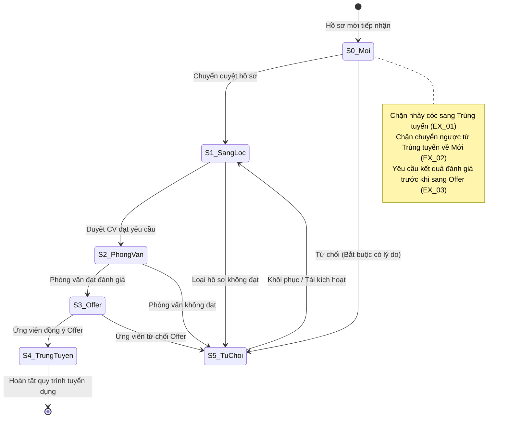

# TÀI LIỆU ĐẶC TẢ CA KIỂM THỬ
## HỌC PHẦN: KIỂM THỬ VÀ ĐẢM BẢO CHẤT LƯỢNG PHẦN MỀM (CSE462)
### BÀI TẬP LỚN / USE CASE: UC_11 - QUẢN LÝ QUY TRÌNH TUYỂN DỤNG (RECRUITMENT PIPELINE MANAGEMENT)

---

## 📌 PHẦN 1: THÔNG TIN CHUNG

- **Mã Use Case:** `UC_11`
- **Tên Use Case:** Quản lý quy trình tuyển dụng *(Recruitment Pipeline Management)*
- **Người đảm nhận / Tạo:** Phạm Văn Hưng
- **Ngày tạo:** 30/01/2026
- **Tác nhân chính (Actor):** Chuyên viên tuyển dụng (HR / Recruiter) - Có đầy đủ thẩm quyền vận hành và quản lý dữ liệu trong hệ thống tuyển dụng chuyên dụng.
- **Tác nhân phụ / Hệ thống liên kết:** Cơ sở dữ liệu tuyển dụng (Database Server), Hệ thống tự động gửi Email thông báo (Mail Server / Event Bus).
- **Mục tiêu Use Case:** 
  1. Cho phép Chuyên viên tuyển dụng theo dõi tiến độ và quản lý trạng thái của ứng viên qua từng giai đoạn trong phễu tuyển dụng (*Recruitment Funnel*).
  2. Thực thi nghiêm ngặt các quy tắc chuyển đổi trạng thái logic nghiệp vụ (*State Machine Rules*), đảm bảo tính tuần tự, ngăn ngừa hành vi nhảy cóc quy trình hoặc chuyển ngược trạng thái bất hợp lệ.
  3. Kiểm tra tính toàn vẹn và các điều kiện tiên quyết của từng giai đoạn (ví dụ: vòng phỏng vấn phải có kết quả đánh giá mới được chuyển sang giai đoạn Đề nghị nhận việc).
  4. Tự động lưu vết lịch sử kiểm toán (*Audit Trail / Activity Log*), cập nhật số lượng thống kê theo giai đoạn và đồng bộ dữ liệu tức thời trên toàn hệ thống.
- **Tiêu chuẩn học thuật và kỹ thuật áp dụng:**
  - Giáo trình Kiểm thử và Đảm bảo chất lượng phần mềm (**CSE462**) – Trường Đại học Thủy Lợi.
  - Chuẩn kiểm thử quốc tế **ISTQB CTFL 2018 v3.1** (Black-box Test Techniques: EP, BVA, Decision Table, State Transition Testing).
  - Chuẩn quy trình kiểm thử phần mềm **ISO/IEC/IEEE 29119-4**.
  - Tiêu chuẩn mô hình chất lượng phần mềm **ISO/IEC 25010** (Functional Suitability, Reliability, Security, Data Integrity, Concurrency).

---

## 🎯 PHẦN 2: PHÂN TÍCH CƠ SỞ KIỂM THỬ VÀ LUỒNG SỰ KIỆN

### 1. Điều kiện tiên quyết (Pre-conditions)
1. Chuyên viên tuyển dụng (HR) đã đăng nhập thành công vào hệ thống quản lý tuyển dụng (Phiên làm việc / Token xác thực còn hiệu lực).
2. Quy trình tuyển dụng và các giai đoạn chuẩn đã được thiết lập sẵn trong CSDL: *Mới (New)*, *Sàng lọc (Screening)*, *Phỏng vấn (Interview)*, *Đề nghị nhận việc (Offer)*, *Trúng tuyển (Hired)*, *Từ chối (Rejected)*.
3. Có ít nhất một hồ sơ ứng viên đang tồn tại ở trạng thái hoạt động trong hệ thống.

### 2. Hậu điều kiện (Post-conditions)
1. Trạng thái của hồ sơ ứng viên được cập nhật chính xác vào CSDL theo đúng quy tắc chuyển trạng thái hợp lệ.
2. Hệ thống ghi vết lịch sử kiểm toán (*Activity Log*) đầy đủ: Mã ứng viên, Trạng thái cũ $\rightarrow$ Trạng thái mới, Thời điểm thực hiện, Mã chuyên viên thực hiện, Lý do (nếu là từ chối/khôi phục).
3. Số lượng thống kê hồ sơ tại giai đoạn nguồn và giai đoạn đích được đồng bộ cập nhật chính xác (Nguồn: $-1$, Đích: $+1$).
4. Kích hoạt sự kiện nghiệp vụ phụ trợ tương ứng (ví dụ: tự động kích hoạt hàng đợi gửi email thông báo lịch hẹn khi chuyển sang giai đoạn Phỏng vấn).

---

### 3. Sơ đồ chuyển đổi trạng thái logic nghiệp vụ (State Transition Diagram)

---

### 4. Phân rã luồng sự kiện chi tiết (Flow of Events - Business Logic Standard)

#### 1.1. Luồng chính (Main Flow - Chuyển đổi trạng thái tuần tự hợp lệ)
- **Bước 1:** Chuyên viên tuyển dụng truy cập vào màn hình Quản lý quy trình tuyển dụng (*Pipeline Management*).
- **Bước 2:** Hệ thống truy vấn CSDL và hiển thị danh sách các hồ sơ ứng viên tương ứng với từng giai đoạn tuyển dụng (Ví dụ: *"Hồ sơ mới"*, *"Sơ tuyển"*, *"Phỏng vấn"*, *"Đề nghị nhận việc"*, *"Trúng tuyển"*, *"Từ chối"*).
- **Bước 3:** Chuyên viên tuyển dụng lựa chọn hồ sơ ứng viên cần xử lý và chọn chuyển từ giai đoạn hiện tại sang giai đoạn tuyển dụng mới.
- **Bước 4:** Hệ thống kiểm tra điều kiện chuyển đổi trạng thái (*Business Rules Validation*) và yêu cầu xác nhận hoặc điền thông tin bổ sung của giai đoạn đích (nếu có).
- **Bước 5:** Chuyên viên xác nhận cập nhật trạng thái mới.
- **Bước 6:** Hệ thống cập nhật trạng thái mới cho hồ sơ trong CSDL, ghi vết lịch sử tiến trình (*Activity Log*) và tự động kích hoạt tiến trình thông báo/email tương ứng.

#### 1.2. Luồng rẽ nhánh và thay thế (Alternative Flows)
- **A1 (Cập nhật trạng thái từ màn hình Chi tiết hồ sơ):** Tại Bước 3, chuyên viên mở xem chi tiết hồ sơ ứng viên và chọn cập nhật trạng thái mới trực tiếp từ bảng điều khiển hồ sơ cá nhân $\rightarrow$ Hệ thống chuyển tiếp sang Bước 4.
- **A2 (Chuyển trạng thái hàng loạt - Batch Processing):** Chuyên viên tích chọn nhiều hồ sơ ứng viên trong cùng một giai đoạn $\rightarrow$ Chọn chức năng *"Chuyển trạng thái hàng loạt"* và chọn giai đoạn đích $\rightarrow$ Hệ thống kiểm tra điều kiện và cập nhật đồng loạt cho tất cả các hồ sơ hợp lệ.
- **A3 (Hủy bỏ thao tác chuyển trạng thái):** Tại Bước 4 hoặc Bước 5, chuyên viên chọn *"Hủy"* hoặc đóng hộp thoại $\rightarrow$ Hệ thống hủy bỏ yêu cầu, giữ nguyên trạng thái hiện tại của hồ sơ trong CSDL và không lưu thay đổi.
- **A4 (Tự động kích hoạt email thông báo theo giai đoạn):** Khi chuyển sang giai đoạn có cấu hình gửi email tự động (như *"Thư mời phỏng vấn"*, *"Từ chối"*...) $\rightarrow$ Hệ thống tự động tạo sẵn nội dung thư theo mẫu để chuyên viên rà soát, cá nhân hóa trước khi gửi đi.
- **A5 (Hoàn tác chuyển trạng thái - Undo Action):** Ngay sau khi cập nhật trạng thái thành công, hệ thống cung cấp tùy chọn *"Hoàn tác"* trong khoảng thời gian hiệu lực 5 giây $\rightarrow$ Chuyên viên kích hoạt hoàn tác $\rightarrow$ Hệ thống tự động khôi phục hồ sơ về trạng thái ngay trước đó và cập nhật lại CSDL.

#### 1.3. Luồng ngoại lệ (Exception Flows)
- **EX_01 (Vi phạm quy trình tuyển dụng / Nhảy bước không cho phép):** Chuyên viên yêu cầu chuyển trạng thái không đúng trình tự quy định (Ví dụ: Chuyển trực tiếp từ *"Hồ sơ mới"* sang *"Trúng tuyển"*) $\rightarrow$ Hệ thống từ chối cập nhật, cảnh báo: *"Không thể chuyển trực tiếp trạng thái này. Vui lòng tuân thủ quy trình tuần tự"* và giữ nguyên trạng thái cũ của hồ sơ.
- **EX_02 (Thiếu thông tin điều kiện bắt buộc của giai đoạn đích):** Chuyển sang giai đoạn mới nhưng thiếu dữ liệu điều kiện tiên quyết (Ví dụ: Chuyển sang *"Phỏng vấn"* nhưng chưa thiết lập thời gian/người phỏng vấn; hoặc chuyển sang *"Từ chối"* nhưng để trống lý do) $\rightarrow$ Hệ thống chặn lưu và yêu cầu nhập đủ thông tin bắt buộc.
- **EX_03 (Hồ sơ đã bị khóa hoặc ở trạng thái kết thúc):** Hồ sơ ứng viên đã ở giai đoạn kết thúc (Đã tuyển dụng hoàn tất, Đã đóng hồ sơ hoặc Ứng viên rút đơn tuyển dụng) $\rightarrow$ Hệ thống từ chối thay đổi, báo lỗi: *"Hồ sơ đã đóng, không thể thay đổi trạng thái"*.
- **EX_04 (Xung đột dữ liệu do tương tranh nhiều phiên làm việc):** Hồ sơ đã bị chuyên viên khác cập nhật trạng thái trong cùng thời điểm $\rightarrow$ Hệ thống kích hoạt cơ chế khóa lạc quan (*Optimistic Locking*), từ chối ghi đè và báo lỗi: *"Dữ liệu hồ sơ đã được cập nhật bởi chuyên viên khác. Vui lòng tải lại trang để nhận dữ liệu mới nhất"*.
- **EX_05 (Lỗi gián đoạn kết nối mạng hoặc máy chủ CSDL):** Mất kết nối mạng hoặc máy chủ CSDL phản hồi timeout trong lúc gửi yêu cầu cập nhật $\rightarrow$ Hệ thống tự động *Rollback transaction*, cảnh báo: *"Lỗi kết nối máy chủ. Thao tác cập nhật chưa được lưu"* và bảo toàn dữ liệu gốc.
- **EX_06 (Phiên làm việc của Chuyên viên hết hạn - Session Expired):** Trong quá trình thao tác, phiên đăng nhập của Chuyên viên tuyển dụng hết hạn (Token JWT hết hiệu lực) $\rightarrow$ Hệ thống từ chối ghi nhận vào CSDL, yêu cầu đăng nhập lại để đảm bảo an toàn thông tin tuyển dụng.

---

## 2. BẢNG TỔNG HỢP DANH SÁCH DỮ LIỆU ĐẦU VÀO (INPUT DATA SPECIFICATION)

| STT | Tên trường dữ liệu | Kiểu dữ liệu | Bắt buộc | Ràng buộc kỹ thuật & Nghiệp vụ | Giá trị mặc định |
| :---: | :--- | :---: | :---: | :--- | :---: |
| **1** | **Hồ sơ ứng viên xử lý (Candidate ID / IDs)** | `UUID / Integer / Array[ID]` | **Bắt buộc** | - Mã định danh hợp lệ của ứng viên, tồn tại trong CSDL và hồ sơ đang mở (chưa bị khóa/xóa). - Hỗ trợ truyền 1 ID (đơn lẻ) hoặc danh sách mảng ID (khi thực hiện chuyển trạng thái hàng loạt theo luồng A2). | Lấy từ hồ sơ được chọn |
| **2** | **Giai đoạn nguồn (Source Stage)** | `Enum` | **Bắt buộc** | - Thuộc tập hợp các giai đoạn chuẩn hóa trong hệ thống: `["Hồ sơ mới", "Sơ tuyển", "Phỏng vấn", "Đề nghị nhận việc", "Trúng tuyển", "Từ chối"]`. | Trạng thái hiện tại của hồ sơ trong DB |
| **3** | **Giai đoạn đích (Target Stage)** | `Enum` | **Bắt buộc** | - Phải tuân theo ma trận chuyển đổi tuần tự (không nhảy cóc quy trình). - Không cho phép chuyển ngược từ trạng thái kết thúc (`Trúng tuyển` $\rightarrow$ `Hồ sơ mới`). | Chưa chọn (Bắt buộc HR chỉ định) |
| **4** | **Lý do từ chối (Rejection Reason)** | `Enum / String` | **Bắt buộc** *(khi đích là "Từ chối")* | - Bắt buộc chọn hoặc nhập khi chuyển hồ sơ sang giai đoạn `Từ chối`. - Độ dài: $1 \le L \le 500$ ký tự; không chứa mã độc XSS/HTML script. - Cho phép chọn từ danh mục chuẩn (*Kỹ năng chưa phù hợp, Mức lương không thỏa thuận được, Ứng viên rút hồ sơ...*) hoặc nhập văn bản chi tiết. | Rỗng (`""`) |
| **5** | **Thông tin lịch phỏng vấn (Interview Schedule)** | `Object` | **Bắt buộc** *(khi đích là "Phỏng vấn")* | - Thời gian phỏng vấn: `DateTime` hợp lệ và $>$ Thời điểm hiện tại. - Người phỏng vấn: Ít nhất 1 chuyên viên chuyên môn/HR, không trùng lịch bận. - Hình thức: `Trực tuyến` (Link Google Meet/Zoom) hoặc `Trực tiếp` (Phòng họp nội bộ). | Khung giờ trống gợi ý sớm nhất |
| **6** | **Thông tin đề nghị nhận việc (Offer Details)** | `Object` | **Bắt buộc** *(khi đích là "Đề nghị nhận việc")* | - Mức lương đề xuất: Kiểu số thực $> 0$. - Ngày bắt đầu dự kiến: `Date` $\ge$ Ngày hiện tại. - Hạn phản hồi thỏa thuận: `DateTime` $>$ Thời điểm gửi offer. | Mức lương chuẩn theo cấu hình JD |
| **7** | **Lý do khôi phục hồ sơ (Reactivation Reason)** | `String` | **Bắt buộc** *(khi khôi phục từ chối về sơ tuyển)* | - Bắt buộc nhập khi khôi phục ứng viên theo luồng thay thế A2. - Độ dài: $1 \le L \le 255$ ký tự, khử mã độc kịch bản; ghi rõ lý do mở lại (bổ sung chứng chỉ, mở thêm chỉ tiêu...). | Rỗng (`""`) |
| **8** | **Thứ tự ưu tiên xử lý (Rank / Priority Index)** | `Integer` | **Tùy chọn** | - Số nguyên dương $1 \le \text{Rank} \le N$ ($N$ là tổng số hồ sơ tại giai đoạn đích), xác định mức độ ưu tiên xử lý hồ sơ. | Thêm vào cuối danh sách ($N + 1$) |
| **9** | **Bộ lọc Vị trí tuyển dụng (Job Filter)** | `UUID / Integer` | **Tùy chọn** | - Lọc bảng quy trình theo mã chiến dịch tuyển dụng / JD hợp lệ và đang hoạt động (`Active`). | `"Tất cả vị trí"` (`ALL`) |
| **10**| **Từ khóa tìm kiếm nhanh (Search Keyword)** | `String` | **Tùy chọn** | - Tìm kiếm theo họ tên ứng viên. - Độ dài: $0 \le L \le 50$ ký tự, tự động khử mã độc SQLi/XSS. | Rỗng (`""`) |

---

## 3. PHÂN TÍCH RÀNG BUỘC TỪNG TRƯỜNG DỮ LIỆU

### 1. Bảng phân tích chi tiết từng trường dữ liệu áp dụng phân vùng tương đương và giá trị biên

| Tên trường | Ràng buộc nghiệp vụ và kỹ thuật | Phân vùng hợp lệ và Giá trị đại diện | Phân vùng không hợp lệ và Giá trị đại diện | Các giá trị biên cần kiểm thử |
| :--- | :--- | :--- | :--- | :--- |
| **Hồ sơ ứng viên xử lý** | - Kiểu: `UUID / Integer / Array` - Bắt buộc phải tồn tại trong CSDL và đang ở trạng thái mở (Active) - Hỗ trợ chuyển đơn lẻ (1 hồ sơ) hoặc chuyển hàng loạt ($1 \le N \le 50$) | - Phân vùng hợp lệ:   + Đơn lẻ: `UV_001` (Nguyễn Văn An)   + Hàng loạt: `["UV_001", "UV_002", "UV_003"]` | - Phân vùng không hợp lệ:   + ID không tồn tại trong CSDL: `UV_999999`   + Hồ sơ đã bị đóng/xóa vĩnh viễn (Kích hoạt EX_03)   + Không chọn hồ sơ nào (`null` hoặc `[]`)   + Vượt quá số lượng 50 hồ sơ/lần | - Biên số lượng hồ sơ chuyển hàng loạt ($N$):   + $N = 0$: Lỗi chưa chọn hồ sơ nào   + $N = 1$: Hợp lệ tối thiểu   + $N = 2$: Hợp lệ cận dưới   + $N = 49$: Hợp lệ cận trên   + $N = 50$: Hợp lệ tối đa một lần chuyển   + $N = 51$: Báo lỗi vượt quá giới hạn 50 hồ sơ |
| **Quy tắc chuyển đổi trạng thái** | - Kiểu: `Enum Transition` - Tập giá trị: `Hồ sơ mới`, `Sơ tuyển`, `Phỏng vấn`, `Đề nghị nhận việc`, `Trúng tuyển`, `Từ chối` - Phải tuân theo quy tắc tuần tự, nghiêm cấm nhảy cóc hoặc chuyển ngược từ kết thúc | - Phân vùng hợp lệ:   + `Hồ sơ mới` $\rightarrow$ `Sơ tuyển`   + `Sơ tuyển` $\rightarrow$ `Phỏng vấn`   + `Phỏng vấn` $\rightarrow$ `Đề nghị nhận việc`   + `Đề nghị nhận việc` $\rightarrow$ `Trúng tuyển`   + Bất kỳ giai đoạn nào $\rightarrow$ `Từ chối`   + `Từ chối` $\rightarrow$ `Sơ tuyển` (Khôi phục) | - Phân vùng không hợp lệ:   + Nhảy cóc: `Hồ sơ mới` $\rightarrow$ `Trúng tuyển` (EX_01)   + Nhảy cóc: `Hồ sơ mới` $\rightarrow$ `Đề nghị nhận việc`   + Nhảy cóc: `Sơ tuyển` $\rightarrow$ `Trúng tuyển`   + Chuyển ngược: `Trúng tuyển` $\rightarrow$ `Hồ sơ mới` (EX_03)   + Chuyển ngược: `Đề nghị nhận việc` $\rightarrow$ `Hồ sơ mới`   + Trạng thái lạ ngoài danh mục enum | - Không áp dụng giá trị biên định lượng (Kiểm thử theo kỹ thuật Bảng chuyển trạng thái - State Transition Testing) |
| **Lý do từ chối hồ sơ** | - Kiểu: `Enum / String` - Bắt buộc khi chuyển sang giai đoạn `Từ chối` - Độ dài: $1 \le L \le 500$ ký tự - Chọn mẫu chuẩn hoặc tự nhập; khử mã độc XSS/HTML Script | - Phân vùng hợp lệ:   + Mẫu chuẩn: `"Kỹ năng chưa phù hợp"`   + Mẫu chuẩn: `"Mức lương không thỏa thuận được"`   + Tự nhập hợp lệ: `"Kỹ năng thuật toán chưa đạt yêu cầu live-code"` | - Phân vùng không hợp lệ:   + Để trống: `""` (Kích hoạt EX_02)   + Chỉ chứa khoảng trắng: `"   "`   + Quá 500 ký tự   + Chứa script: `` | - Biên độ dài lý do từ chối ($L$):   + $L = 0$: `""` (Báo lỗi để trống EX_02)   + $L = 1$: `"K"` (Hợp lệ tối thiểu)   + $L = 2$: `"Ko"` (Hợp lệ)   + $L = 499$: Chuỗi 499 ký tự (Hợp lệ)   + $L = 500$: Chuỗi 500 ký tự (Hợp lệ tối đa)   + $L = 501$: Báo lỗi vượt quá 500 ký tự |
| **Thời gian phỏng vấn thiết lập** | - Kiểu: `DateTime` - Bắt buộc khi chuyển sang giai đoạn `Phỏng vấn` - Ràng buộc: $T > T_{\text{hiện tại}}$ và cách hiện tại ít nhất 15 phút | - Phân vùng hợp lệ:   + Khung giờ tương lai hợp lệ: $T \ge T_{\text{hiện tại}} + 15\text{ phút}$ (Ví dụ: Ngày mai 09:00 AM) | - Phân vùng không hợp lệ:   + Quá khứ: $T < T_{\text{hiện tại}}$   + Tương lai quá cận: $0 \le T - T_{\text{hiện tại}} < 15\text{ phút}$   + Để trống ngày giờ (EX_02)   + Ngày sai cú pháp: `"31/02/2026"` | - Biên thời gian hẹn ($T$ so với $T_{\text{hiện tại}}$):   + $T = T_{\text{hiện tại}} - 1\text{ phút}$ (Lỗi quá khứ)   + $T = T_{\text{hiện tại}}$ (Lỗi thời gian hiện tại)   + $T = T_{\text{hiện tại}} + 14\text{ phút}$ (Lỗi dưới 15 phút)   + $T = T_{\text{hiện tại}} + 15\text{ phút}$ (Hợp lệ tối thiểu)   + $T = T_{\text{hiện tại}} + 16\text{ phút}$ (Hợp lệ) |
| **Mức lương đề xuất trong Offer** | - Kiểu: `Float / Decimal` - Bắt buộc khi chuyển sang giai đoạn `Đề nghị nhận việc` - Ràng buộc: $1,000,000 \le \text{Salary} \le 500,000,000\text{ VNĐ}$ | - Phân vùng hợp lệ:   + Lương chuẩn: `15000000` (15 triệu VNĐ)   + Lương quản lý: `45000000` (45 triệu VNĐ) | - Phân vùng không hợp lệ:   + Bằng 0 hoặc âm: `0`, `-5000000`   + Dưới mức tối thiểu: `800000`   + Vượt trần: `600000000`   + Nhập ký tự chữ: `"hai mươi triệu"` | - Biên mức lương đề xuất (VNĐ):   + $\text{Salary} = 0$: Lỗi lương không dương   + $\text{Salary} = 999,999$: Lỗi dưới mức sàn   + $\text{Salary} = 1,000,000$: Hợp lệ tối thiểu   + $\text{Salary} = 1,000,001$: Hợp lệ   + $\text{Salary} = 500,000,000$: Hợp lệ tối đa   + $\text{Salary} = 500,000,001$: Lỗi vượt trần |
| **Lý do khôi phục hồ sơ** | - Kiểu: `String` - Bắt buộc khi khôi phục từ `Từ chối` về `Sơ tuyển` (Luồng A2) - Độ dài: $1 \le L \le 255$ ký tự, khử XSS | - Phân vùng hợp lệ:   + `"Ứng viên bổ sung chứng chỉ IELTS 7.5 và mở thêm chỉ tiêu"` | - Phân vùng không hợp lệ:   + Để trống: `""`   + Quá 255 ký tự   + Chứa thẻ script: `` | Hệ thống khử mã độc (sanitize/encode HTML entity); lưu văn bản an toàn vào CSDL; không kích hoạt mã độc | P1 - Cao |
| **TC_UC11_034** | Chống tấn công SQL Injection khi lọc quy trình theo vị trí tuyển dụng | Kiểm thử bảo mật | Security Testing | Thực hiện lọc danh sách quy trình theo mã vị trí | 1. Nhập chuỗi SQLi vào tham số lọc vị trí tuyển dụng | Tham số: `' OR 1=1 --` | Hệ thống sử dụng Prepared Statement/ORM; không bị rò rỉ dữ liệu hoặc lỗi cú pháp SQL | P1 - Cao |
| **TC_UC11_035** | Kiểm tra tính nhất quán số lượng tổng hợp trước và sau khi chuyển trạng thái | Kiểm thử chức năng | Data Consistency | Giai đoạn Mới có 10 hồ sơ, Sàng lọc có 5 hồ sơ | 1. Chuyển 1 hồ sơ từ Mới sang Sàng lọc; 2. Kiểm tra số lượng | Tổng số hồ sơ = 15 | Số lượng giai đoạn Mới giảm còn 9, Sàng lọc tăng lên 6; tổng số hồ sơ toàn quy trình không đổi | P2 - Trung bình |
| **TC_UC11_036** | Chống gửi trùng lặp yêu cầu cập nhật liên tiếp (Idempotency) | Kiểm thử độ tin cậy | Reliability Testing | Thao tác gửi yêu cầu chuyển trạng thái | 1. Kích hoạt liên tiếp 2 yêu cầu cập nhật trạng thái trong 100ms | Cùng payload và Idempotency-Key | Chỉ 1 yêu cầu được xử lý và ghi CSDL; yêu cầu thứ 2 bị bỏ qua an toàn; không tạo log trùng lặp | P2 - Trung bình |
| **TC_UC11_037** | Cập nhật trạng thái thành công khi đang áp dụng đồng thời bộ lọc và tìm kiếm | Kiểm thử tích hợp | Integration Flow | Đang lọc theo vị trí Java Dev và từ khóa tìm kiếm "An" | 1. Chọn hồ sơ trong kết quả lọc; 2. Chuyển trạng thái; 3. Kiểm tra | Bộ lọc kép: Job + Tên | Trạng thái hồ sơ được cập nhật thành công; kết quả lọc và tìm kiếm vẫn được duy trì nhất quán | P2 - Trung bình |
| **TC_UC11_038** | Kiểm tra toàn vẹn dữ liệu khi cập nhật hồ sơ không tồn tại hoặc đã xóa | Kiểm thử nghiệp vụ / DB | Data Integrity | Hồ sơ ứng viên đã bị xóa khỏi hệ thống trong CSDL | 1. Gửi yêu cầu chuyển trạng thái với Candidate ID không tồn tại | Candidate ID = 999999 (Invalid ID) | Hệ thống từ chối cập nhật; trả về mã lỗi 404 Not Found; bảo toàn toàn vẹn cơ sở dữ liệu | P1 - Cao |
